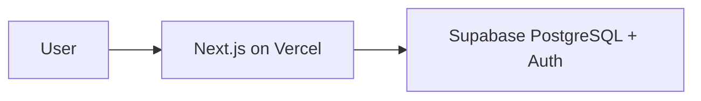

# Sports Community Platform

A premium event participation management platform for sports communities — starting with badminton and pickleball, designed to support any activity or sport.

**Replace WhatsApp participant lists.** Not a court booking system.

---

## Vision

Community admins create events and share a link on WhatsApp. Members join first-come-first-served. Waitlists and automatic promotion on cancellation eliminate manual list editing. Admins manage attendance from a mobile-first dashboard.

See [docs/01_PRODUCT_VISION.md](./docs/01_PRODUCT_VISION.md) for full product vision.

---

## Goals

- Ship MVP quickly with beautiful UX
- Simple modular monolith architecture
- Secure (RLS-enforced RBAC)
- Scalable schema for future growth
- Free tier viable (Vercel + Supabase)
- AI-buildable milestone-by-milestone

---

## MVP Features

| Feature | Description |
|---------|-------------|
| Authentication | Google OAuth via Supabase |
| User Profile | Display name, avatar, phone |
| Community | Admin creates and manages one community |
| Events | Create, publish, share link, cancel |
| Join / Leave | FCFS join with atomic capacity enforcement |
| Waitlist | Auto-assignment when full |
| Auto-Promotion | First waitlisted promoted on cancellation |
| Participant List | Ordered list with avatars |
| Attendance | Admin marks present / absent / no-show |
| Admin Dashboard | Upcoming events, quick actions |
| UI | Responsive, dark mode default, premium polish |
| RBAC | Guest, Member, Admin, Super Admin |

---

## Tech Stack

| Layer | Technology |
|-------|------------|
| Frontend | Next.js (App Router), TypeScript, Tailwind CSS |
| UI | shadcn/ui, Framer Motion, Lucide icons |
| Forms | React Hook Form + Zod |
| Backend | Supabase (PostgreSQL, Auth, RLS) |
| Hosting | Vercel |
| Package Manager | pnpm |
| Testing | Vitest, Playwright |
| Lint / Format | ESLint, Prettier |

---

## Architecture

Modular monolith: single Next.js app on Vercel, Supabase for data and auth. Server Components by default. Server Actions for mutations. PostgreSQL RPC for atomic join/waitlist logic. RLS enforces all authorization.



Full architecture: [docs/04_SYSTEM_ARCHITECTURE.md](./docs/04_SYSTEM_ARCHITECTURE.md)

---

## Repository Structure

```
sports-community-app/
├── docs/                 # Project documentation (start here)
├── .cursor/rules/        # AI development guardrails
├── .github/              # Copilot instructions, CI (M17)
├── supabase/             # Migrations and seed (M2+)
└── src/                  # Application code (M0+)
    ├── app/              # Next.js App Router
    ├── components/       # UI and domain components
    ├── features/         # Feature modules
    ├── lib/              # Supabase, validations, utils
    └── types/            # TypeScript types
```

---

## Documentation

All documentation lives in [`docs/`](./docs/README.md).

| Start here | Document |
|------------|----------|
| Building the app | [Implementation Plan](./docs/16_IMPLEMENTATION_PLAN.md) |
| AI sessions | [AI Development Guide](./docs/15_AI_DEVELOPMENT_GUIDE.md) |
| Product scope | [Requirements](./docs/02_REQUIREMENTS.md) |
| Database | [Database Design](./docs/05_DATABASE_DESIGN.md) |
| UI design | [UI System](./docs/10_UI_SYSTEM.md) |

**Full index:** [docs/README.md](./docs/README.md)

---

## Development Workflow

### Current Status

**Documentation bootstrap complete.** Application code begins at Milestone M0.

### Getting Started (After M0)

```bash
# Prerequisites: Node 20+, pnpm, Supabase CLI, Docker

git clone <repo-url>
cd sports-community-app
pnpm install
cp .env.example .env.local
# Fill in Supabase credentials

supabase start
supabase db reset
pnpm dev
```

Full setup instructions will be finalized in M18. See [Deployment](./docs/13_DEPLOYMENT.md).

### Milestone Workflow

1. Read current milestone in [Implementation Plan](./docs/16_IMPLEMENTATION_PLAN.md)
2. Create branch: `milestone/M{N}-{name}`
3. Implement scope only
4. Run `pnpm lint && pnpm typecheck && pnpm test`
5. Complete manual test checklist
6. Commit with suggested message from plan
7. Merge to main

### AI-Assisted Development

This repository is optimized for AI-first development. Cursor rules in `.cursor/rules/` enforce architecture constraints. Start each session with:

```
Read docs/16_IMPLEMENTATION_PLAN.md and implement the next incomplete milestone.
Follow docs/15_AI_DEVELOPMENT_GUIDE.md.
```

---

## Key Product Rules

1. **Not a court booking system** — event participation only
2. **FCFS join** — atomic, never overbook capacity
3. **Auto waitlist promotion** — synchronous on leave/cancel
4. **RLS is authoritative** — UI hiding is not security
5. **Mobile-first** — primary use is WhatsApp links on phones

---

## License

Private project. All rights reserved. License terms will be published if the project is open-sourced.

---

## Contributing

Single maintainer + AI workflow for MVP. External contribution guidelines will be published after public launch.

For architectural changes, add an ADR to [docs/18_DECISIONS.md](./docs/18_DECISIONS.md).
