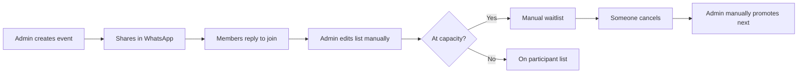
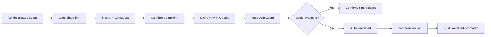

# Product Vision

## Related Documents

- [Requirements](./02_REQUIREMENTS.md)
- [User Stories](./03_USER_STORIES.md)
- [System Architecture](./04_SYSTEM_ARCHITECTURE.md)
- [Roadmap](./17_ROADMAP.md)
- [Decisions](./18_DECISIONS.md)

---

## Vision Statement

Build the premium event participation platform that replaces manually edited WhatsApp participant lists for sports communities — starting with badminton and pickleball, designed to serve any activity or sport worldwide.

---

## The Problem

Community admins and sports organizers today manage event participation through WhatsApp messages:

1. Admin posts an event message in a group chat
2. Members reply "in" or "+1"
3. Admin manually edits a numbered participant list
4. When full, admin tracks a separate waitlist manually
5. Cancellations require renumbering and notifying the next person
6. Attendance on event day is another manual checklist

This workflow is error-prone, slow, unfair at capacity boundaries, and does not scale. It creates friction for admins and uncertainty for players.

---

## The Solution

A mobile-first web application where:

- Admins create events and share a single link on WhatsApp
- Members join with one tap (first come, first served)
- Waitlist assignment and promotion happen automatically
- Participant lists stay accurate in real time
- Admins manage attendance from a dedicated dashboard

**This is not a court booking system.** We do not manage facility inventory, time slots, or reservations. We manage **who is participating in an event** — the human coordination layer that WhatsApp fails at.

---

## Target Users

### MVP Primary Personas

| Persona | Description | Core Need |
|---------|-------------|-----------|
| **Community Admin** | Runs a badminton or pickleball group (10–40 regular players) | Create events, share links, manage lists and attendance without spreadsheets |
| **Sports Organizer** | Same as admin; may run weekly sessions | Reliable FCFS join and automatic waitlist |
| **Player** | Group member who joins events via WhatsApp links | Quick join/leave, see position and event details on mobile |

### Future Personas

| Persona | Description |
|---------|-------------|
| **Community Owner** | Manages brand and settings across multiple groups |
| **Club Owner** | Facility-associated club with paid membership |
| **Sports Academy** | Structured programs with skill levels |
| **Tournament Organizer** | Brackets, divisions, larger capacity events |

---

## Product Goals

| Goal | Description |
|------|-------------|
| **Ship MVP quickly** | Working product in weeks, not months |
| **Beautiful UX** | Premium 2026 aesthetic; feels like Nike Training Club meets Linear |
| **Simple architecture** | Modular monolith; one developer + AI can maintain |
| **Secure** | OWASP-aligned; RLS-enforced authorization |
| **Scalable** | Schema and patterns support growth without rewrite |
| **Modern** | Next.js App Router, Server Components, Supabase |
| **Fast** | Mobile-first performance; optimistic UI where safe |
| **Free tier viable** | Vercel + Supabase free tiers for MVP |

---

## Differentiators

1. **WhatsApp-native workflow** — Share link, done. No app install required (PWA-ready web).
2. **Automatic waitlist fairness** — Atomic FCFS; no admin renumbering.
3. **Sport-agnostic core** — Badminton and pickleball first; any activity later.
4. **Premium polish** — Dark mode, motion, empty states that delight.
5. **Admin-first power tools** — Dashboard built for organizers, not generic CRUD.

---

## Non-Goals (MVP and Near-Term)

The following are explicitly **out of scope** for MVP:

- Court or facility booking and reservation management
- Payment processing and subscriptions
- Native iOS/Android apps
- WhatsApp bot or API integration
- Push notifications
- Calendar sync (Google Calendar, iCal)
- Leaderboards and skill ratings
- QR check-in
- Multi-community admin UI (schema supports; UI deferred)
- Tournament brackets
- Analytics dashboards beyond basic event stats

See [Roadmap](./17_ROADMAP.md) for when these may be addressed.

---

## Current Workflow (To Replace)

## Target Workflow

---

## Design Philosophy

The product should feel like a premium sports application released in 2026.

**Inspired by:** Nike Training Club, Apple Fitness, Linear, Notion Calendar, Arc Browser, modern fintech products.

**Characteristics:**

- Minimal and elegant, never visually noisy
- Premium without being corporate
- Mobile-first layouts and touch targets
- Excellent dark mode (default)
- Subtle glass effects only on navigation and overlays
- Large typography and generous spacing
- Beautiful gradients used sparingly for emphasis
- Rounded cards and smooth transitions
- Meaningful micro-interactions and motion hierarchy
- Delightful empty, loading, and error states
- Accessibility first (WCAG 2.1 AA target)

Full tokens and component specs: [UI System](./10_UI_SYSTEM.md), [Component Library](./11_COMPONENT_LIBRARY.md).

---

## Success Metrics (MVP)

| Metric | Target |
|--------|--------|
| Admin can create and share event | Under 2 minutes |
| Member can join from WhatsApp link | Under 30 seconds (including Google sign-in) |
| Waitlist promotion on cancel | Immediate (< 1 second perceived) |
| Mobile usability | All core flows usable one-handed on 375px width |
| Zero overbooking | Capacity never exceeded under concurrent joins |

---

## Strategic Principles

1. **Replace WhatsApp lists, not WhatsApp itself** — WhatsApp remains the discovery channel; we are the system of record for participation.
2. **Fairness by default** — FCFS and automatic promotion are non-negotiable product rules.
3. **Admin trust** — Admins must trust participant counts; accuracy over features.
4. **Extensible sport model** — Never hardcode badminton/pickleball in business logic.
5. **AI-buildable milestones** — Every feature ships as a testable increment documented in [Implementation Plan](./16_IMPLEMENTATION_PLAN.md).

---

## Product Name

Working product name: **Sports Community Platform**. Repository name: `sports-community-app`. A consumer-facing brand name may be chosen before public launch.
