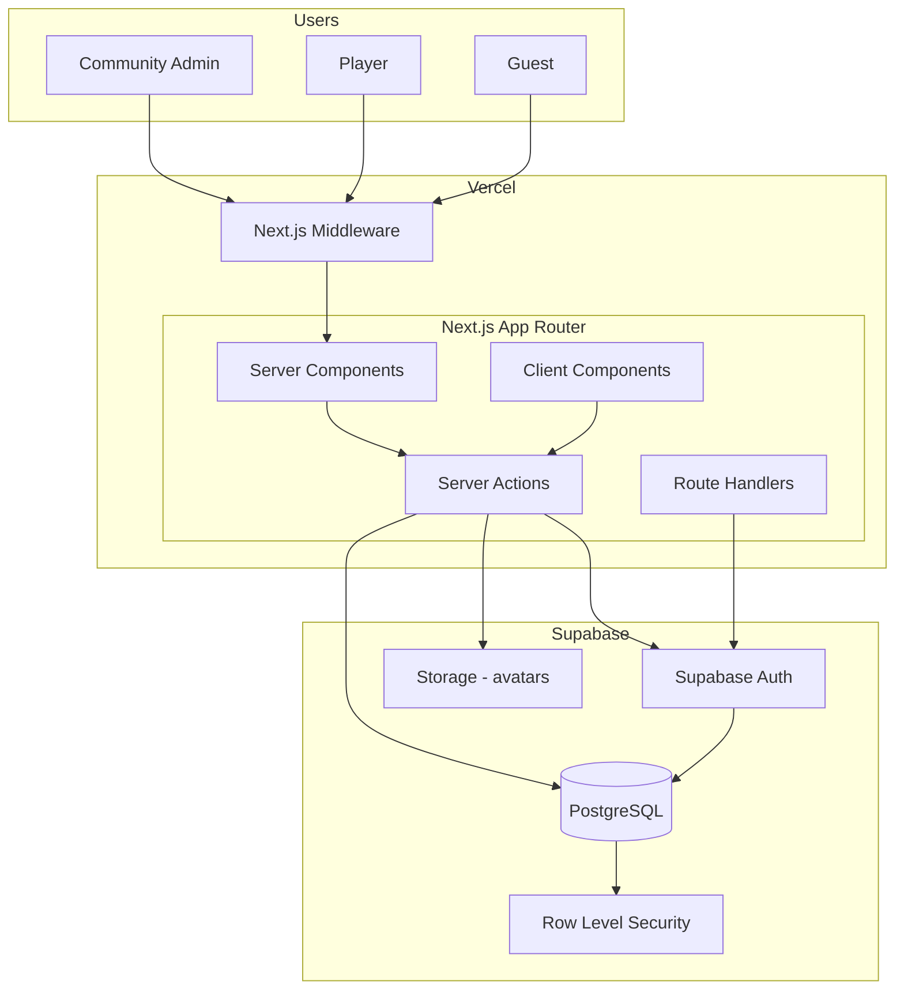
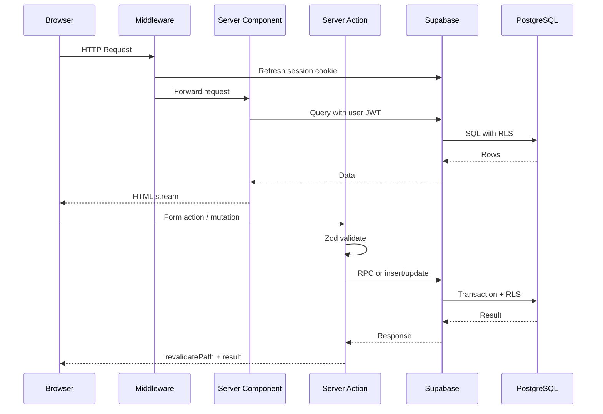
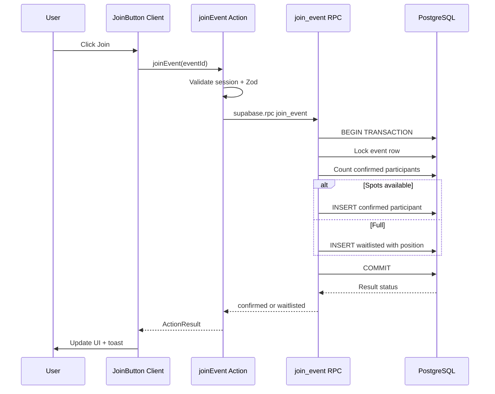
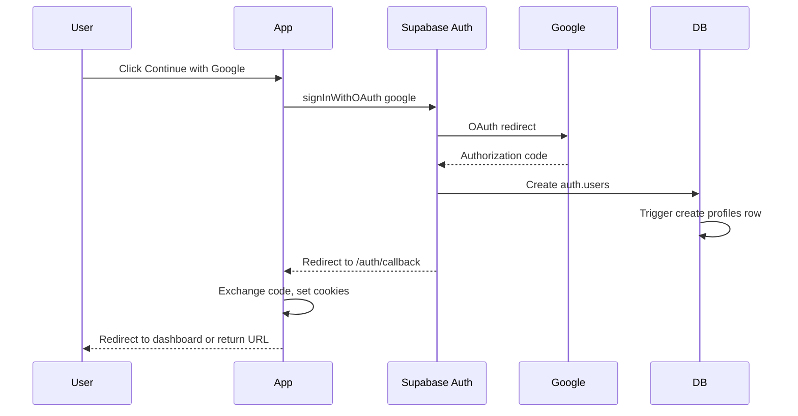
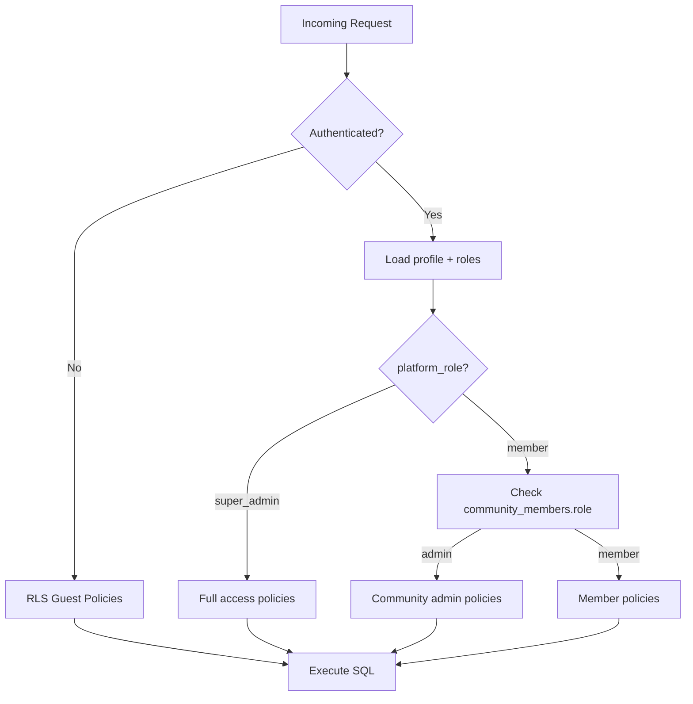
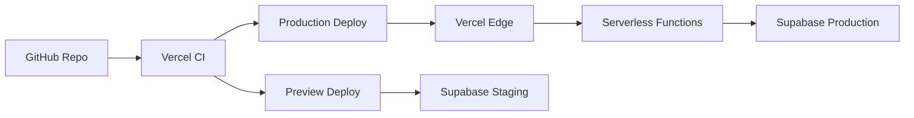

# System Architecture

## Related Documents

- [Decisions](./18_DECISIONS.md)
- [Database Design](./05_DATABASE_DESIGN.md)
- [RBAC](./06_RBAC.md)
- [Authentication](./07_AUTHENTICATION.md)
- [Security](./08_SECURITY.md)
- [API Strategy](./09_API_STRATEGY.md)
- [Coding Standards](./14_CODING_STANDARDS.md)
- [Implementation Plan](./16_IMPLEMENTATION_PLAN.md)

---

## Overview

The Sports Community Platform is a **modular monolith**: a single Next.js application deployed on Vercel, backed by Supabase (PostgreSQL + Auth + RLS). There are no microservices. Feature boundaries are enforced by folder structure and module exports, not network boundaries.

**This is not a court booking system.** The architecture models event participation, not facility reservations.

---

## High-Level Architecture



---

## Technology Stack

| Layer | Technology | Responsibility |
|-------|------------|----------------|
| Presentation | Next.js App Router, React 19 | Pages, layouts, RSC/RCC split |
| Styling | Tailwind CSS, shadcn/ui | Design tokens, components |
| Animation | Framer Motion | Client-side motion |
| Mutations | Server Actions | Form submissions, join/leave |
| Reads | Server Components + Supabase server client | Data fetching at request time |
| Validation | Zod | Runtime input validation |
| Auth | Supabase Auth + `@supabase/ssr` | Sessions, OAuth |
| Data | PostgreSQL via Supabase | Persistent storage |
| Authorization | RLS policies | Database-enforced RBAC |
| Hosting | Vercel | SSR, edge middleware, CI |

---

## Folder Structure

```
sports-community-app/
├── .cursor/rules/           # AI guardrails
├── .github/                 # Copilot instructions, CI (future)
├── docs/                    # Project documentation
├── public/                  # Static assets
├── supabase/
│   ├── migrations/          # SQL migrations
│   └── seed.sql             # Activity types seed
├── src/
│   ├── app/
│   │   ├── (auth)/          # Login, auth callback
│   │   │   ├── login/
│   │   │   └── auth/callback/
│   │   ├── (dashboard)/     # Protected admin area
│   │   │   ├── layout.tsx
│   │   │   ├── page.tsx     # Dashboard home
│   │   │   ├── events/
│   │   │   ├── community/
│   │   │   └── settings/
│   │   ├── (public)/        # Public routes
│   │   │   └── e/[slug]/    # Public event page
│   │   ├── layout.tsx       # Root layout
│   │   ├── page.tsx         # Landing
│   │   ├── globals.css
│   │   └── api/             # Route handlers (auth callback fallback)
│   ├── components/
│   │   ├── ui/              # shadcn primitives
│   │   ├── domain/          # EventCard, ParticipantList, etc.
│   │   └── layout/          # Navbar, Sidebar, BottomNav
│   ├── features/
│   │   ├── auth/
│   │   │   ├── actions.ts
│   │   │   ├── queries.ts
│   │   │   └── components/
│   │   ├── communities/
│   │   ├── events/
│   │   ├── participants/
│   │   └── attendance/
│   ├── lib/
│   │   ├── supabase/
│   │   │   ├── client.ts    # Browser client
│   │   │   ├── server.ts    # Server client
│   │   │   └── middleware.ts
│   │   ├── validations/     # Zod schemas
│   │   ├── utils/
│   │   └── constants/
│   ├── types/
│   │   ├── database.ts      # Generated Supabase types
│   │   └── index.ts
│   └── hooks/               # Client-only hooks
├── middleware.ts            # Session refresh, route protection
├── next.config.ts
├── tailwind.config.ts
├── tsconfig.json
├── package.json
└── pnpm-lock.yaml
```

---

## Request Lifecycle



### Middleware (`middleware.ts`)

1. Create Supabase server client from cookies
2. Call `supabase.auth.getUser()` to refresh session
3. Protect `(dashboard)/**` — redirect to `/login` if unauthenticated
4. Redirect authenticated users away from `/login` to dashboard
5. Public routes `/e/[slug]` pass through without auth

### Server Components (default)

- Fetch data with Supabase server client
- No client JavaScript for static reads
- Pass serializable props to Client Components
- Use `Suspense` for streaming slow sections

### Client Components (`"use client"`)

Use only when needed:

- Interactive forms with immediate client validation feedback
- Theme toggle (`next-themes`)
- Framer Motion animations
- Modals, drawers, toasts
- Optimistic UI for join/leave buttons

### Server Actions

- Mark with `"use server"` in `features/*/actions.ts`
- Validate all inputs with Zod
- Return typed `ActionResult<T>` (see [API Strategy](./09_API_STRATEGY.md))
- Call `revalidatePath` or `revalidateTag` after mutations
- Never expose service role key

---

## Data Flow: Join Event



---

## Authentication Flow

See [Authentication](./07_AUTHENTICATION.md) for detail.



---

## Authorization Flow

See [RBAC](./06_RBAC.md) for permission matrix.



---

## Error Handling

### Layers

| Layer | Strategy |
|-------|----------|
| Zod validation | Return `{ success: false, error: { code: 'VALIDATION_ERROR', fieldErrors } }` |
| Supabase/RLS | Map Postgres codes; return user-safe message |
| Unexpected | Log server-side; return generic message; never leak stack traces |
| Client | Toast for errors; inline field errors for forms |

### Error Boundary

- `app/error.tsx` — route-level error UI
- `app/global-error.tsx` — root fallback
- Domain components use `ErrorState` component (see [Component Library](./11_COMPONENT_LIBRARY.md))

### Logging

- MVP: `console.error` in Server Actions with structured context `{ action, userId, eventId, error }`
- Future: Vercel Log Drain or Sentry integration

---

## Caching Strategy

| Data | Strategy |
|------|----------|
| Public event page | `revalidatePath('/e/[slug]')` on mutation; optional 60s ISR for high traffic |
| Dashboard lists | Dynamic; revalidate on event CRUD |
| User profile | Per-request; short cache via React `cache()` wrapper on queries |
| Static assets | Immutable cache headers via Vercel |

Do not cache user-specific data at CDN without careful keying. Default to dynamic rendering for authenticated routes.

---

## Scalability

### MVP Scale (Free Tier)

- Hundreds of communities, thousands of users
- Join bursts handled by PostgreSQL transaction isolation
- Participant list pagination at 50+ rows

### Growth Path

1. **Read replicas** — Supabase Pro read replicas for dashboard queries
2. **Connection pooling** — Supabase Supavisor (built-in)
3. **Realtime** — Supabase Realtime for live participant lists (post-MVP)
4. **Background jobs** — Supabase Edge Functions + pg_cron for notifications (post-MVP)
5. **CDN** — Static assets and public event pages at edge

No microservice split until independent scaling domains emerge (e.g., notification service at 100K+ users).

---

## Background Jobs (Future)

Not in MVP. Documented for architecture continuity:

| Job | Trigger | Purpose |
|-----|---------|---------|
| Waitlist notification | On promotion | Email/push user promoted |
| Event reminder | 24h before start | Remind confirmed participants |
| Soft delete purge | Weekly cron | Hard delete rows deleted > 1 year |
| Analytics aggregation | Nightly | Roll up attendance stats |

Implementation: Supabase Edge Functions or Vercel Cron invoking secure endpoints with service role.

---

## Monitoring (Future)

| Concern | Tool |
|---------|------|
| Uptime | Vercel Analytics |
| Errors | Sentry (future) |
| Database | Supabase Dashboard metrics |
| Performance | Vercel Speed Insights |

MVP relies on Vercel and Supabase built-in dashboards.

---

## Environment Variables

| Variable | Scope | Description |
|----------|-------|-------------|
| `NEXT_PUBLIC_SUPABASE_URL` | Client + Server | Supabase project URL |
| `NEXT_PUBLIC_SUPABASE_ANON_KEY` | Client + Server | Anon/public key (RLS enforced) |
| `SUPABASE_SERVICE_ROLE_KEY` | Server only (scripts) | Bypass RLS; never in user paths |
| `NEXT_PUBLIC_APP_URL` | Client + Server | Canonical app URL for OAuth redirects |

See [Deployment](./13_DEPLOYMENT.md) for full list.

---

## Module Boundaries

Each feature module exports:

- `actions.ts` — Server Actions (public API of feature)
- `queries.ts` — Server-side data fetchers
- `types.ts` — Feature-specific types
- `components/` — Feature UI

Cross-feature imports:

- Features may import from `lib/`, `types/`, `components/ui`
- Features should not import another feature's internal components directly; use shared `components/domain` for cross-feature UI

---

## Server vs Client Decision Matrix

| Need | Use |
|------|-----|
| Fetch event data for page | Server Component |
| Display participant list (static) | Server Component |
| Join button with loading state | Client Component + Server Action |
| Theme toggle | Client Component |
| Admin form with validation | Client form + Server Action |
| Page metadata / SEO | Server Component `generateMetadata` |
| Animation on list items | Client wrapper with Framer Motion |

---

## Security Architecture Summary

Defense in depth:

1. **Middleware** — Session validity
2. **Server Actions** — Zod validation, auth check
3. **Supabase RLS** — Row-level authorization
4. **UI** — Hide unauthorized controls

Full detail: [Security](./08_SECURITY.md).

---

## Deployment Architecture



See [Deployment](./13_DEPLOYMENT.md).
