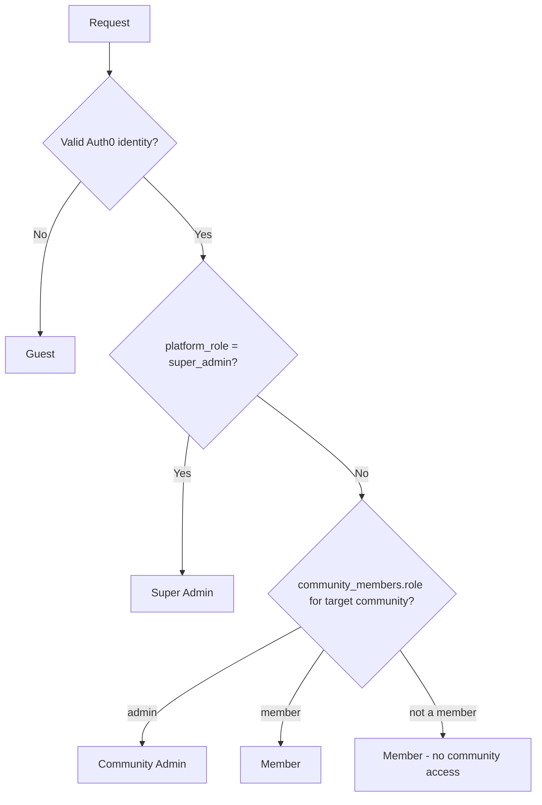

# Role-Based Access Control (RBAC)

## Related Documents

- [Requirements](./02_REQUIREMENTS.md)
- [Database Design](./05_DATABASE_DESIGN.md)
- [Authentication](./07_AUTHENTICATION.md)
- [Security](./08_SECURITY.md)
- [API Strategy](./09_API_STRATEGY.md)

---

## Overview

Authorization uses a two-layer role model:

1. **Platform roles** — on `profiles.platform_role`
2. **Community roles** — on `community_members.role`

**Guest** is not stored; it represents a request without a valid Auth0 identity or mapped application profile. Supabase Auth is not the identity provider.

All permissions are enforced by **Supabase Row Level Security (RLS)** using trusted application role data. Auth0 authenticates identity; it does not grant community roles. UI hiding of unauthorized actions is defense-in-depth only and must never be the sole control.

**Migration note:** The original M2 migrations use `auth.uid()` as a profile UUID. The forward Auth0 migration replaces caller lookups with `current_profile_id()` in policies and RPCs. Validate the migration and test guest, invalid-token, and cross-community access before deployment. Never cast Auth0 `sub` to UUID.

---

## Role Definitions

| Role | Storage | Description |
|------|---------|-------------|
| **Guest** | No session | Unauthenticated visitor; limited public read |
| **Member** | `profiles.platform_role = 'member'` | Authenticated user; default on signup |
| **Community Admin** | `community_members.role = 'admin'` | Manages one community's events, participants, attendance |
| **Super Admin** | `profiles.platform_role = 'super_admin'` | Platform operator; full access |

A user can be **Member** at platform level and **Admin** in one community simultaneously.

### Effective Role Resolution



---

## Resources and Actions

| Resource | Actions |
|----------|---------|
| Profile | view, update, delete |
| Community | view, create, update, delete |
| Community Member | view, add, update role, remove |
| Activity Type | view, manage |
| Event | view, create, update, cancel, delete |
| Event Participant | view, join, leave, remove |
| Waitlist | view, promote (automatic) |
| Attendance | view, mark, update |
| Audit Log | view, create |
| Admin Dashboard | access |

---

## Permission Matrix

### Profile (`profiles`)

| Action | Guest | Member | Community Admin | Super Admin |
|--------|-------|--------|-----------------|-------------|
| View own profile | No | Yes | Yes | Yes |
| View co-community member profiles | No | Yes (shared community) | Yes | Yes |
| View any profile | No | No | No | Yes |
| Update own profile | No | Yes | Yes | Yes |
| Update other profiles | No | No | No | Yes |
| Delete own profile (soft) | No | Yes | Yes | Yes |
| Delete other profiles | No | No | No | Yes |

### Community (`communities`)

| Action | Guest | Member | Community Admin | Super Admin |
|--------|-------|--------|-----------------|-------------|
| View own communities | No | Yes (member of) | Yes | Yes |
| View community by slug (public) | Yes (published metadata) | Yes | Yes | Yes |
| Create community | No | Yes (MVP: one per user) | Yes | Yes |
| Update community settings | No | No | Yes (own community) | Yes |
| Delete community (soft) | No | No | Yes (own community) | Yes |

### Community Members (`community_members`)

| Action | Guest | Member | Community Admin | Super Admin |
|--------|-------|--------|-----------------|-------------|
| View members list | No | Yes (same community) | Yes | Yes |
| Add member | No | No | Yes | Yes |
| Change member role | No | No | Yes | Yes |
| Remove member | No | No | Yes | Yes |
| Self-join via event | No | Yes (auto on first event join) | Yes | Yes |

### Activity Types (`activity_types`)

| Action | Guest | Member | Community Admin | Super Admin |
|--------|-------|--------|-----------------|-------------|
| View | Yes | Yes | Yes | Yes |
| Create / Update / Delete | No | No | No | Yes |

### Events (`events`)

| Action | Guest | Member | Community Admin | Super Admin |
|--------|-------|--------|-----------------|-------------|
| View published event (public page) | Yes | Yes | Yes | Yes |
| View draft event | No | No | Yes (own community) | Yes |
| View community event list | No | Yes (member) | Yes | Yes |
| Create event | No | No | Yes (own community) | Yes |
| Update event | No | No | Yes (own community, before completed) | Yes |
| Cancel event | No | No | Yes (own community) | Yes |
| Delete event (soft) | No | No | Yes (own community) | Yes |

### Event Participants (`event_participants`)

| Action | Guest | Member | Community Admin | Super Admin |
|--------|-------|--------|-----------------|-------------|
| View confirmed list | Yes (published event) | Yes | Yes | Yes |
| View waitlist | No | Own position only | Yes (full list) | Yes |
| Join event (FCFS) | No | Yes (community member) | Yes | Yes |
| Leave event | No | Own participation | Own + any | All |
| Remove participant | No | No | Yes | Yes |

### Attendance (`attendance_records`)

| Action | Guest | Member | Community Admin | Super Admin |
|--------|-------|--------|-----------------|-------------|
| View own attendance | No | Yes | Yes | Yes |
| View event attendance | No | No | Yes | Yes |
| Mark attendance | No | No | Yes | Yes |
| Update attendance | No | No | Yes | Yes |

### Audit Logs (`audit_logs`)

| Action | Guest | Member | Community Admin | Super Admin |
|--------|-------|--------|-----------------|-------------|
| View | No | No | No | Yes |
| Create (via admin actions) | No | No | Yes (system) | Yes |

### Admin Dashboard

| Action | Guest | Member | Community Admin | Super Admin |
|--------|-------|--------|-----------------|-------------|
| Access dashboard | No | No | Yes | Yes |
| Platform admin panel | No | No | No | Yes |

---

## Restrictions and Business Rules

| Rule | Enforcement |
|------|-------------|
| Guest cannot join events | RPC requires a mapped `current_profile_id()`; UI shows sign-in prompt |
| Member must belong to community to join event | RPC checks `is_community_member` |
| Cannot join draft/cancelled/completed events | RPC validates `events.status = 'published'` |
| Cannot join past events | RPC validates `events.starts_at > now()` |
| Cannot exceed capacity for confirmed | RPC transaction lock |
| Direct client INSERT on event_participants denied | RLS policy: no INSERT except via SECURITY DEFINER RPC |
| MVP one community per admin | Server Action check + unique constraint on owner creating second community |
| Admin cannot mark attendance before event day | Server Action validates date (configurable grace window) |
| Soft-deleted entities invisible | All SELECT policies include `deleted_at IS NULL` |

---

## RLS Policy Definitions

### `profiles`

```sql
ALTER TABLE profiles ENABLE ROW LEVEL SECURITY;

-- profiles_select_own
CREATE POLICY profiles_select_own ON profiles FOR SELECT
  USING (id = current_profile_id() AND deleted_at IS NULL);

-- profiles_select_community_peers
CREATE POLICY profiles_select_community_peers ON profiles FOR SELECT
  USING (
    deleted_at IS NULL AND (
      id = current_profile_id()
      OR EXISTS (
        SELECT 1 FROM community_members cm1
        JOIN community_members cm2 ON cm1.community_id = cm2.community_id
        WHERE cm1.profile_id = current_profile_id()
          AND cm2.profile_id = profiles.id
      )
      OR is_super_admin()
    )
  );

-- profiles_update_own
CREATE POLICY profiles_update_own ON profiles FOR UPDATE
  USING (id = current_profile_id() AND deleted_at IS NULL)
  WITH CHECK (id = current_profile_id());

-- profiles_super_admin_all
CREATE POLICY profiles_super_admin_all ON profiles FOR ALL
  USING (is_super_admin());
```

### `communities`

```sql
ALTER TABLE communities ENABLE ROW LEVEL SECURITY;

-- communities_select_member
CREATE POLICY communities_select_member ON communities FOR SELECT
  USING (
    deleted_at IS NULL AND (
      is_community_member(id)
      OR is_super_admin()
    )
  );

-- communities_insert_authenticated
CREATE POLICY communities_insert_authenticated ON communities FOR INSERT
  WITH CHECK (current_profile_id() IS NOT NULL AND owner_id = current_profile_id());

-- communities_update_admin
CREATE POLICY communities_update_admin ON communities FOR UPDATE
  USING (is_community_admin(id) AND deleted_at IS NULL);

-- communities_delete_admin (soft delete via update)
CREATE POLICY communities_soft_delete_admin ON communities FOR UPDATE
  USING (is_community_admin(id))
  WITH CHECK (true);
```

### `community_members`

```sql
ALTER TABLE community_members ENABLE ROW LEVEL SECURITY;

-- community_members_select
CREATE POLICY community_members_select ON community_members FOR SELECT
  USING (is_community_member(community_id) OR is_super_admin());

-- community_members_insert_admin
CREATE POLICY community_members_insert_admin ON community_members FOR INSERT
  WITH CHECK (is_community_admin(community_id) OR is_super_admin());

-- community_members_update_admin
CREATE POLICY community_members_update_admin ON community_members FOR UPDATE
  USING (is_community_admin(community_id) OR is_super_admin());

-- community_members_delete_admin
CREATE POLICY community_members_delete_admin ON community_members FOR DELETE
  USING (is_community_admin(community_id) OR is_super_admin());
```

### `activity_types`

```sql
ALTER TABLE activity_types ENABLE ROW LEVEL SECURITY;

CREATE POLICY activity_types_select_all ON activity_types FOR SELECT
  USING (true);

CREATE POLICY activity_types_manage_super ON activity_types FOR ALL
  USING (is_super_admin());
```

### `events`

```sql
ALTER TABLE events ENABLE ROW LEVEL SECURITY;

-- events_public_select: published events visible to all
CREATE POLICY events_public_select ON events FOR SELECT
  USING (
    deleted_at IS NULL
    AND status = 'published'
  );

-- events_member_select: members see all non-deleted in their community
CREATE POLICY events_member_select ON events FOR SELECT
  USING (
    deleted_at IS NULL
    AND (is_community_member(community_id) OR is_super_admin())
  );

-- events_insert_admin
CREATE POLICY events_insert_admin ON events FOR INSERT
  WITH CHECK (
    is_community_admin(community_id)
    AND created_by = current_profile_id()
  );

-- events_update_admin
CREATE POLICY events_update_admin ON events FOR UPDATE
  USING (is_community_admin(community_id) AND deleted_at IS NULL);
```

### `event_participants`

```sql
ALTER TABLE event_participants ENABLE ROW LEVEL SECURITY;

-- event_participants_select_confirmed_public
CREATE POLICY event_participants_select ON event_participants FOR SELECT
  USING (
    EXISTS (
      SELECT 1 FROM events e
      WHERE e.id = event_participants.event_id
        AND e.deleted_at IS NULL
        AND (
          e.status = 'published'
          OR is_community_member(e.community_id)
          OR is_super_admin()
        )
    )
    AND (
      status = 'confirmed'
      OR profile_id = current_profile_id()
      OR is_community_admin((
        SELECT community_id FROM events WHERE id = event_participants.event_id
      ))
      OR is_super_admin()
    )
  );

-- Deny direct INSERT/UPDATE/DELETE — mutations via RPC only
-- No INSERT/UPDATE/DELETE policies for regular users
```

RPC functions `join_event`, `leave_event`, `remove_participant` run as `SECURITY DEFINER` with internal authorization checks.

### `attendance_records`

```sql
ALTER TABLE attendance_records ENABLE ROW LEVEL SECURITY;

-- attendance_select_admin
CREATE POLICY attendance_select_admin ON attendance_records FOR SELECT
  USING (
    is_community_admin((
      SELECT community_id FROM events WHERE id = attendance_records.event_id
    ))
    OR is_super_admin()
  );

-- attendance_select_own
CREATE POLICY attendance_select_own ON attendance_records FOR SELECT
  USING (
    EXISTS (
      SELECT 1 FROM event_participants ep
      WHERE ep.id = attendance_records.participant_id
        AND ep.profile_id = current_profile_id()
    )
  );

-- attendance_insert_admin
CREATE POLICY attendance_insert_admin ON attendance_records FOR INSERT
  WITH CHECK (
    is_community_admin((
      SELECT community_id FROM events WHERE id = event_id
    ))
  );

-- attendance_update_admin
CREATE POLICY attendance_update_admin ON attendance_records FOR UPDATE
  USING (
    is_community_admin((
      SELECT community_id FROM events WHERE id = event_id
    ))
  );
```

### `audit_logs`

```sql
ALTER TABLE audit_logs ENABLE ROW LEVEL SECURITY;

CREATE POLICY audit_logs_select_super ON audit_logs FOR SELECT
  USING (is_super_admin());

CREATE POLICY audit_logs_insert_admin ON audit_logs FOR INSERT
  WITH CHECK (current_profile_id() IS NOT NULL);
```

---

## App-Layer Role Checks

Use in Server Components and Server Actions for UX (not security):

```typescript
// src/lib/auth/roles.ts (to be implemented in M3/M14)
export async function requireCommunityAdmin(communityId: string): Promise<void>;
export async function requireSuperAdmin(): Promise<void>;
export async function getCommunityRole(communityId: string): Promise<'admin' | 'member' | null>;
```

Pattern:

1. Server Action calls `requireCommunityAdmin` — fast fail with 403 UX message
2. Supabase mutation still goes through RLS/RPC — authoritative enforcement

---

## Super Admin Bootstrap

Initial super admin set via SQL after first deploy:

```sql
UPDATE profiles SET platform_role = 'super_admin'
WHERE id = '<first-admin-uuid>';
```

Never expose super admin promotion in UI for MVP.

---

## RBAC Testing Checklist

| Test | Expected |
|------|----------|
| Guest reads published event | Allowed |
| Guest joins event | Denied |
| Member joins own community event | Allowed |
| Member joins other community event | Denied |
| Member views waitlist positions of others | Denied |
| Admin views full waitlist | Allowed |
| Member creates event | Denied |
| Admin creates event | Allowed |
| Member removes other participant | Denied |
| Direct Supabase INSERT participant | Denied by RLS |
| Super admin reads audit logs | Allowed |
| Member reads audit logs | Denied |

See [Testing](./12_TESTING.md) for automated RLS test approach.

---

## Future RBAC Extensions

| Feature | Role Impact |
|---------|-------------|
| Community Owner | New platform-level or community flag |
| Paid membership | `membership_tier` on community_members |
| Tournament organizer | Scoped role with bracket permissions |
| Read-only member | `community_role = 'viewer'` |

Schema supports new enum values without breaking existing policies.
