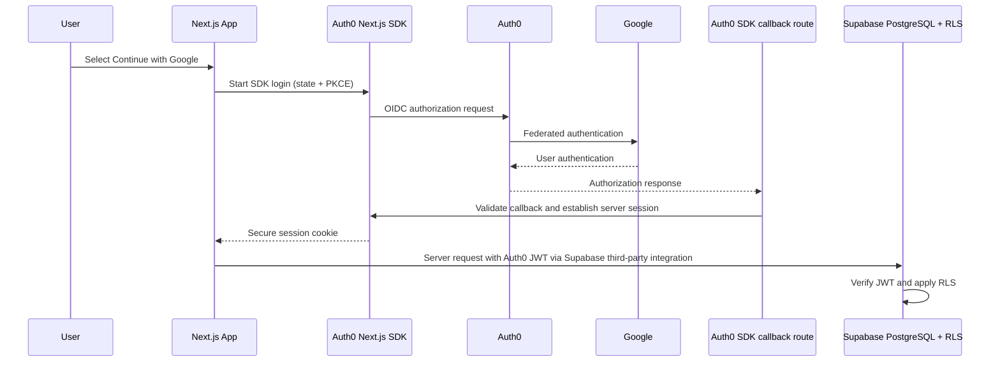

# Authentication

## Related Documents

- [Requirements](./02_REQUIREMENTS.md)
- [RBAC](./06_RBAC.md)
- [Security](./08_SECURITY.md)
- [System Architecture](./04_SYSTEM_ARCHITECTURE.md)
- [Database Design](./05_DATABASE_DESIGN.md)
- [Repository Audit](./19_REPOSITORY_AUDIT.md)
- [Decisions](./18_DECISIONS.md)

---

## Status and provider boundary

**Target:** Auth0 is the single identity provider. Google OAuth is configured as an Auth0 social connection, not as a second app identity provider. Supabase is used for PostgreSQL, migrations, RLS, and optional Storage—not Supabase Auth.

**Implementation status:** Auth0 MCP onboarding created the Regular Web Application and saved its credentials to the ignored `.env.local`; the SDK wiring and forward database migration are in place. Live Google sign-in and real Supabase JWT validation have not yet passed. M3 is incomplete; do not begin M4 until its acceptance criteria are verified. See [Implementation Plan](./16_IMPLEMENTATION_PLAN.md) and [Repository Audit](./19_REPOSITORY_AUDIT.md).

Use the [official Auth0 Next.js SDK](https://auth0.com/docs/quickstart/webapp/nextjs) and its current App Router integration pattern. Use standards-based OIDC/OAuth Authorization Code Flow with PKCE and the SDK-managed server session. Do not build password storage, token issuance, or OAuth protocol handling from scratch.

## Authentication methods

| Method | Status | Provider |
|---|---|---|
| Google social login | MVP | Google connection managed by Auth0 |
| Phone OTP | Future, only if required | Evaluate Auth0 free-plan support and all provider costs first |
| Email OTP / magic link | Future, only if required | Evaluate Auth0 free-plan support and terms first |
| Email/password | Not planned | No application-managed passwords |

Do not add Supabase Auth or another IdP. Account linking and additional login methods require a product requirement and a documented security review.

## Sign-in and session flow



The SDK handles state, nonce, PKCE, callback validation, session storage, and logout according to its current documented pattern. The application must not put ID/access tokens in URLs, local storage, logs, or client-visible props. Session cookies must be Secure in production, HttpOnly, and use an appropriate SameSite policy.

## Token and Supabase integration

Follow the [official Supabase Auth0 third-party integration](https://supabase.com/docs/guides/auth/third-party/auth0) rather than inventing token plumbing. The current guide requires an Auth0 Post-Login Action to add the literal `role: "authenticated"` claim to the **ID token** and passing that ID token to Supabase. The server may obtain it from the SDK-managed session token set and provide it only to the server-side Supabase client. Require it to be present; do not expose it to browser JavaScript or logs. This claim selects a PostgreSQL role; it does **not** grant an application persona.

Configure a Post-Login Action for the Auth0 application:

```js
exports.onExecutePostLogin = async (_event, api) => {
  api.idToken.setCustomClaim("role", "authenticated");
};
```

Attach the deployed Action to the **Login / Post Login (`post-login`) trigger**. In the current Auth0 Dashboard, open **Actions → Triggers → Login** and add the Action there; older instructions may call this **Actions → Flows → Login**. Ensure the tenant ID and region match the local Supabase `[auth.third_party.auth0]` settings.

- Verify the Auth0 issuer, JWT signature, expiry, intended application audience, and required Supabase `role: authenticated` claim through the official integration and SDK.
- Missing, invalid, or expired credentials must fail closed for protected operations.
- Never trust roles from browser input, user-editable metadata, or arbitrary token claims.
- `platform_role` and `community_members.role` are application authorization data held in PostgreSQL and enforced by RLS.
- Auth0 Organization roles are not used for community access; the free-tier audit identifies per-Organization RBAC as a paid-plan capability.
- Do not copy Supabase Auth's `auth.users` lifecycle assumptions into the Auth0 integration.
- The MVP has no separate public REST API, so community permissions are checked in server operations and RLS rather than delegated to token scopes. If a public API is added, require Auth0 access tokens minted for that API and validate signature, issuer, audience, expiry, and required permissions server-side.

### Stable application profile identity

Auth0 subjects are external string identifiers and are never application UUIDs. Migration `20260101000003_auth0_identity.sql` preserves internal `profiles.id` values, adds a unique issuer/subject binding, and moves caller lookups to `current_profile_id()`. It also removes the Supabase Auth profile trigger, rewrites RLS policies and SECURITY DEFINER RPCs, provisions profiles idempotently from trusted claims, and prevents authenticated users from changing platform roles or identity bindings.

Legacy profiles are intentionally not auto-linked by email. An account migration or unlink/deletion flow is not implemented; if existing user data must be preserved, define a trusted migration process before deployment. pgTAP regression coverage is in `supabase/tests/20260101000003_auth0_identity.test.sql`, but it still needs to run against local Supabase. Never cast Auth0 `sub` directly to UUID or treat it as an application profile UUID.

## Routes and redirects

| Route | Auth required | Behavior |
|---|---|---|
| `/` | No | Public landing page |
| `/login` | No | Start Auth0 login; authenticated users go to dashboard |
| `/e/[slug]` | No | Public event view |
| `/dashboard/**` | Yes | Redirect to login with a safe return path |
| `/onboarding` | Yes | Complete a missing application profile |

Only accept same-origin relative return paths. Reject protocol-relative paths, external URLs, malformed encodings, and unexpected schemes. Protect every Server Action, Route Handler, and data query server-side; route middleware and hidden controls are supplemental only.

## Profile lifecycle

On first successful Auth0 login, create or resolve an application profile by trusted `iss` + `sub` in a transaction or an equivalent race-safe server/database operation. Store only profile data needed by the product; do not rely on Supabase Auth triggers. Default the trusted database `platform_role` to `member`; super-admin grants are explicit, audited, and never self-service.

Profile creation and login must be idempotent. Do not create duplicate profiles during concurrent callbacks. An absent or inconsistent mapping must fail safely and be observable without logging tokens or unnecessary personal data.

## Sign-out and failures

Use the SDK's logout flow to clear the application session and Auth0 session as appropriate, then redirect to a validated local destination. Handle cancelled login, callback/state/nonce failures, provider outage, invalid session, and quota/rate limits with safe retryable messages. Never claim a user was authenticated if the callback or session validation failed.

## Configuration

Exact variable names must follow the current SDK configuration. The Supabase integration uses the Auth0 ID token; do not add an API audience or request an access token unless the selected SDK/integration configuration requires it. Keep all secrets server-only:

| Variable | Required | Scope |
|---|---|---|
| `AUTH0_DOMAIN` | Yes | Server |
| `AUTH0_CLIENT_ID` | Yes | Server/configuration |
| `AUTH0_CLIENT_SECRET` | Yes | Server secret |
| `AUTH0_SECRET` | Yes | Server secret used to protect session |
| `APP_BASE_URL` | Yes | Server/configuration |
| Supabase URL and publishable key | Database integration | Publishable; RLS is mandatory |

Safe empty placeholders belong in `.env.example`; real values stay in ignored `.env.local` or deployment secrets. Never expose client secrets, signing secrets, Management API tokens, or privileged database keys with a `NEXT_PUBLIC_` prefix.

### Auth0 application and local setup

Auth0 MCP onboarding created the application and saved its credentials locally. It also configured the callback/logout URLs and enabled Auth0's `skip_non_verifiable_callback_uri_confirmation_prompt` setting for the localhost callback. No secrets should be sent in chat. Finish these remaining steps:

1. Open the new application's [Auth0 settings](https://manage.auth0.com/dashboard/us/dev-viqq4bj1e522n2ob/applications/z0a11AOEiIFkfewIP0pLXA3qej7p0SPg/settings). The onboarding tool configured:
   - **Allowed Callback URLs:** `http://localhost:3000/auth/callback`
   - **Allowed Logout URLs:** `http://localhost:3000/`
   - **Skip non-verifiable callback URI confirmation:** enabled
2. Confirm the application uses the default **RS256** signing algorithm; Supabase does not support HS256 or PS256 for this integration.
3. In **Authentication → Social**, enable the Google connection and make it available to this application. For development, use Auth0's test/development provider keys if offered; otherwise configure Google's OAuth client in the connection settings. The application starts this connection using the `google-oauth2` connection name.
4. Go to **Actions → Library → Create Action → Build from scratch**. Select the **Login / Post Login** trigger and add:

   ```js
   exports.onExecutePostLogin = async (event, api) => {
     api.idToken.setCustomClaim("role", "authenticated");
   };
   ```

   Deploy the Action. Then open **Actions → Triggers → Login** and attach the deployed Action to the post-login trigger. Older dashboard instructions may refer to **Actions → Flows → Login**; the current dashboard groups these under Triggers. The `role` claim belongs on the ID token; do not set application roles in Auth0.
5. The local Supabase Auth0 integration is enabled in `supabase/config.toml` for tenant `dev-viqq4bj1e522n2ob` in region `us`.
6. Auth0 MCP saved `AUTH0_DOMAIN`, `AUTH0_CLIENT_ID`, `AUTH0_CLIENT_SECRET`, `AUTH0_SECRET`, and `APP_BASE_URL` to ignored `.env.local`. Do not overwrite, open, or share that file. Generate a new session secret only for another environment:

   ```bash
   openssl rand -hex 32
   ```

   Store that output only as `AUTH0_SECRET` in another environment's ignored `.env.local`. Never send or commit the secret.
7. Install/start the local Supabase stack using the [Deployment guide](./13_DEPLOYMENT.md). Run `supabase status` and copy its local **API URL** and **publishable/anon key** into `NEXT_PUBLIC_SUPABASE_URL` and `NEXT_PUBLIC_SUPABASE_ANON_KEY` in `.env.local`. Local Studio is available at the Studio URL reported by the CLI.
8. From the repository root, run:

   ```bash
   supabase start
   supabase db reset
   supabase test db
   pnpm dev
   ```

   Visit `http://localhost:3000/login`, complete Google sign-in, confirm `/dashboard` loads, then sign out and confirm the protected route redirects back to sign-in.

The Auth0 tenant/client now exist; enabling Google and attaching the Post-Login Action remain dashboard steps. The local Supabase stack and its environment values are also required for end-to-end sign-in. None of these steps require enabling billing.

### Auth0 tenant name and Management API scopes

The Auth0 **application display name** is RallyNook. The tenant's technical name/domain (`dev-viqq4bj1e522n2ob.us.auth0.com`) is a separate identifier and is unchanged. The tenant URL slug itself cannot be renamed in place; using a different slug means creating a new tenant and migrating its applications, connections, Actions, and settings. Do not recreate this tenant just to change the product label.

Auth0 separately supports an editable tenant **friendly name**. To set it to `RallyNook`, use the tenant settings in the Dashboard or the [Management API tenant-settings endpoint](https://auth0.com/docs/api/management/v2/tenants/patch-settings) with the `update:tenant_settings` scope and body `{"friendly_name":"RallyNook"}`. This changes the friendly label, not the tenant URL. It has not been changed by the Auth0 application rename.

An Auth0 custom domain can present a branded login URL, but it masks rather than renames the underlying tenant domain. Auth0's [custom-domain documentation](https://auth0.com/docs/customize/custom-domains) says a free custom domain requires a valid payment card on file for verification, though Auth0 says it will not charge the card. It is optional and is not configured for this project.

An Auth0 MCP error that requests `read:actions` is about the MCP's authorization to the **Auth0 Management API**, not this application's OIDC scopes or API permissions:

- If the MCP uses managed sign-in, reconnect/reauthorize it with the required Management API scope. If the consent flow does not let you choose scopes, the MCP provider must request `read:actions`; creating or changing Actions additionally requires the appropriate `create:actions` and/or `update:actions` permissions.
- If you operate the MCP's own Machine-to-Machine application, authorize only the required permissions under **Applications → [MCP application] → APIs → Auth0 Management API**. Do not add Management API scopes to RallyNook's Regular Web Application.

## Testing

Required tests include:

| Test | Expected |
|---|---|
| OAuth callback success | Valid callback establishes an SDK-managed session |
| Invalid state/nonce or callback | Rejected; no authenticated session |
| Wrong issuer/audience, expired, malformed JWT | Supabase/data boundary rejects request |
| Protected route without session | Redirect to login with safe `next` |
| Unsafe return URL | Rejected or redirected to a local default |
| Sign-out | Session cleared; protected route inaccessible |
| First login and concurrent callback | Exactly one correctly bound profile |
| Forged client role | No change to database authorization |
| RLS/RPC caller mapping | Only the correct internal profile's authorized rows are accessible |

Use mocks for deterministic local CI; live Auth0 E2E is opt-in and requires explicitly configured credentials. Do not make basic build or unit tests depend on a hosted provider.
