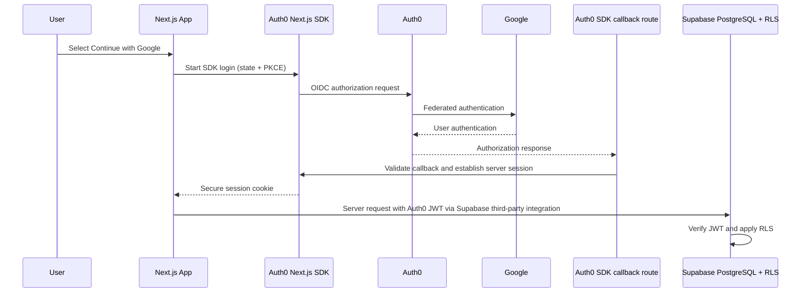

# Authentication

## Related Documents

- [Requirements](./02_REQUIREMENTS.md)
- [RBAC](./06_RBAC.md)
- [Security](./08_SECURITY.md)
- [System Architecture](./04_SYSTEM_ARCHITECTURE.md)
- [Database Design](./05_DATABASE_DESIGN.md)
- [Repository Audit](./19_REPOSITORY_AUDIT.md)
- [Decisions](./18_DECISIONS.md)

---

## Status and provider boundary

**Target:** Auth0 is the single identity provider. Google OAuth is configured as an Auth0 social connection, not as a second app identity provider. Supabase is used for PostgreSQL, migrations, RLS, and optional Storage—not Supabase Auth.

**Implementation status:** The prior Supabase Auth flow is being replaced by Auth0. The Auth0 SDK wiring and forward database migration are present, but live identity-provider and database integration tests have not yet passed. M3 is incomplete; do not begin M4 until its acceptance criteria are verified. See [Implementation Plan](./16_IMPLEMENTATION_PLAN.md) and [Repository Audit](./19_REPOSITORY_AUDIT.md).

Use the [official Auth0 Next.js SDK](https://auth0.com/docs/quickstart/webapp/nextjs) and its current App Router integration pattern. Use standards-based OIDC/OAuth Authorization Code Flow with PKCE and the SDK-managed server session. Do not build password storage, token issuance, or OAuth protocol handling from scratch.

## Authentication methods

| Method | Status | Provider |
|---|---|---|
| Google social login | MVP | Google connection managed by Auth0 |
| Phone OTP | Future, only if required | Evaluate Auth0 free-plan support and all provider costs first |
| Email OTP / magic link | Future, only if required | Evaluate Auth0 free-plan support and terms first |
| Email/password | Not planned | No application-managed passwords |

Do not add Supabase Auth or another IdP. Account linking and additional login methods require a product requirement and a documented security review.

## Sign-in and session flow



The SDK handles state, nonce, PKCE, callback validation, session storage, and logout according to its current documented pattern. The application must not put ID/access tokens in URLs, local storage, logs, or client-visible props. Session cookies must be Secure in production, HttpOnly, and use an appropriate SameSite policy.

## Token and Supabase integration

Follow the [official Supabase Auth0 third-party integration](https://supabase.com/docs/guides/auth/third-party/auth0) rather than inventing token plumbing. The current guide requires an Auth0 Post-Login Action to add the literal `role: "authenticated"` claim to the **ID token** and passing that ID token to Supabase. The server may obtain it from the SDK-managed session token set and provide it only to the server-side Supabase client. Require it to be present; do not expose it to browser JavaScript or logs. This claim selects a PostgreSQL role; it does **not** grant an application persona.

Configure a Post-Login Action for the Auth0 application:

```js
exports.onExecutePostLogin = async (_event, api) => {
  api.idToken.setCustomClaim("role", "authenticated");
};
```

Enable the Action in the Login flow. The matching Auth0 tenant must also be configured in the local Supabase `[auth.third_party.auth0]` settings; keep the integration disabled until the real tenant ID and region are known.

- Verify the Auth0 issuer, JWT signature, expiry, intended application audience, and required Supabase `role: authenticated` claim through the official integration and SDK.
- Missing, invalid, or expired credentials must fail closed for protected operations.
- Never trust roles from browser input, user-editable metadata, or arbitrary token claims.
- `platform_role` and `community_members.role` are application authorization data held in PostgreSQL and enforced by RLS.
- Auth0 Organization roles are not used for community access; the free-tier audit identifies per-Organization RBAC as a paid-plan capability.
- Do not copy Supabase Auth's `auth.users` lifecycle assumptions into the Auth0 integration.
- The MVP has no separate public REST API, so community permissions are checked in server operations and RLS rather than delegated to token scopes. If a public API is added, require Auth0 access tokens minted for that API and validate signature, issuer, audience, expiry, and required permissions server-side.

### Stable application profile identity

Auth0 subjects are external string identifiers and are never application UUIDs. Migration `20260101000003_auth0_identity.sql` preserves internal `profiles.id` values, adds a unique issuer/subject binding, and moves caller lookups to `current_profile_id()`. It also removes the Supabase Auth profile trigger, rewrites RLS policies and SECURITY DEFINER RPCs, provisions profiles idempotently from trusted claims, and prevents authenticated users from changing platform roles or identity bindings.

Legacy profiles are intentionally not auto-linked by email. An account migration or unlink/deletion flow is not implemented; if existing user data must be preserved, define a trusted migration process before deployment. pgTAP regression coverage is in `supabase/tests/20260101000003_auth0_identity.test.sql`, but it still needs to run against local Supabase. Never cast Auth0 `sub` directly to UUID or treat it as an application profile UUID.

## Routes and redirects

| Route | Auth required | Behavior |
|---|---|---|
| `/` | No | Public landing page |
| `/login` | No | Start Auth0 login; authenticated users go to dashboard |
| `/e/[slug]` | No | Public event view |
| `/dashboard/**` | Yes | Redirect to login with a safe return path |
| `/onboarding` | Yes | Complete a missing application profile |

Only accept same-origin relative return paths. Reject protocol-relative paths, external URLs, malformed encodings, and unexpected schemes. Protect every Server Action, Route Handler, and data query server-side; route middleware and hidden controls are supplemental only.

## Profile lifecycle

On first successful Auth0 login, create or resolve an application profile by trusted `iss` + `sub` in a transaction or an equivalent race-safe server/database operation. Store only profile data needed by the product; do not rely on Supabase Auth triggers. Default the trusted database `platform_role` to `member`; super-admin grants are explicit, audited, and never self-service.

Profile creation and login must be idempotent. Do not create duplicate profiles during concurrent callbacks. An absent or inconsistent mapping must fail safely and be observable without logging tokens or unnecessary personal data.

## Sign-out and failures

Use the SDK's logout flow to clear the application session and Auth0 session as appropriate, then redirect to a validated local destination. Handle cancelled login, callback/state/nonce failures, provider outage, invalid session, and quota/rate limits with safe retryable messages. Never claim a user was authenticated if the callback or session validation failed.

## Configuration

Exact variable names must follow the current SDK configuration. The Supabase integration uses the Auth0 ID token; do not add an API audience or request an access token unless the selected SDK/integration configuration requires it. Keep all secrets server-only:

| Variable | Required | Scope |
|---|---|---|
| `AUTH0_DOMAIN` | Yes | Server |
| `AUTH0_CLIENT_ID` | Yes | Server/configuration |
| `AUTH0_CLIENT_SECRET` | Yes | Server secret |
| `AUTH0_SECRET` | Yes | Server secret used to protect session |
| `APP_BASE_URL` | Yes | Server/configuration |
| Supabase URL and publishable key | Database integration | Publishable; RLS is mandatory |

Safe empty placeholders belong in `.env.example`; real values stay in ignored `.env.local` or deployment secrets. Never expose client secrets, signing secrets, Management API tokens, or privileged database keys with a `NEXT_PUBLIC_` prefix.

### One-time local dashboard setup

Live sign-in cannot be completed until the project owner configures these dashboards; no credentials should be sent in chat:

1. In Auth0, create a **Regular Web Application** and enable the Google social connection for it. The Auth0 free plan's current quotas and terms are tracked in the [repository audit](./19_REPOSITORY_AUDIT.md); do not enable a paid plan or billing.
2. Set the application's allowed callback URL to `http://localhost:3000/auth/callback`, allowed logout URL to `http://localhost:3000`, and allowed web origin to `http://localhost:3000`. Use the equivalent production URLs only after hosting has been approved.
3. Add and enable the Post-Login Action shown above. It must set `role: "authenticated"` on the **ID token**.
4. In the local `supabase/config.toml`, enable `[auth.third_party.auth0]` and set `tenant` to the Auth0 tenant name and `tenant_region` to the tenant's region using the format required by the installed Supabase CLI version. Do not put secrets in this file.
5. Put the Auth0 domain, client ID, client secret, a fresh 32-byte hex `AUTH0_SECRET`, and local Supabase URL/publishable key in ignored `.env.local`. For example, generate the session secret locally with `openssl rand -hex 32`; do not reuse an example or share its output.
6. Run `supabase start`, `supabase db reset`, and `supabase test db`. Then run `pnpm dev` and verify Google sign-in, sign-out, and `/dashboard` access.

Auth0 tenant/client setup and Supabase's third-party-provider verification are external prerequisites, not a reason to enable billing. Until configured, `/login` shows a setup message and `/dashboard` redirects without exposing protected content.

## Testing

Required tests include:

| Test | Expected |
|---|---|
| OAuth callback success | Valid callback establishes an SDK-managed session |
| Invalid state/nonce or callback | Rejected; no authenticated session |
| Wrong issuer/audience, expired, malformed JWT | Supabase/data boundary rejects request |
| Protected route without session | Redirect to login with safe `next` |
| Unsafe return URL | Rejected or redirected to a local default |
| Sign-out | Session cleared; protected route inaccessible |
| First login and concurrent callback | Exactly one correctly bound profile |
| Forged client role | No change to database authorization |
| RLS/RPC caller mapping | Only the correct internal profile's authorized rows are accessible |

Use mocks for deterministic local CI; live Auth0 E2E is opt-in and requires explicitly configured credentials. Do not make basic build or unit tests depend on a hosted provider.
