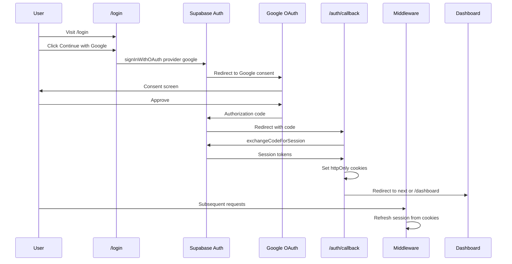

# Authentication

## Related Documents

- [Requirements](./02_REQUIREMENTS.md)
- [RBAC](./06_RBAC.md)
- [Security](./08_SECURITY.md)
- [System Architecture](./04_SYSTEM_ARCHITECTURE.md)
- [Database Design](./05_DATABASE_DESIGN.md)
- [Decisions](./18_DECISIONS.md)

---

## Overview

Authentication is handled by **Supabase Auth** with session management via `@supabase/ssr`. MVP supports **Google OAuth** only. The architecture supports adding Phone OTP and Email OTP later without schema changes.

Authorization (what users can do) is separate — see [RBAC](./06_RBAC.md).

---

## MVP Authentication Methods

| Method | Status | Provider |
|--------|--------|----------|
| Google OAuth | MVP | Supabase Auth + Google Cloud Console |
| Phone OTP | Future | Supabase Auth Phone provider |
| Email OTP / Magic Link | Future | Supabase Auth Email provider |
| Email/Password | Not planned | — |

---

## Authentication Flow (Google OAuth)



---

## Session Management

### Cookie Strategy

Supabase SSR uses secure cookies managed by `@supabase/ssr`:

| Cookie | Purpose |
|--------|---------|
| `sb-access-token` | Short-lived JWT |
| `sb-refresh-token` | Refresh token for session renewal |

Configured in Supabase server client. In production:

- `Secure` flag enabled (HTTPS only)
- `SameSite=Lax` (default Supabase SSR behavior)
- `HttpOnly` where supported by Supabase cookie adapter

### Session Refresh

`middleware.ts` runs on every matched request:

1. Create Supabase server client from request cookies
2. Call `supabase.auth.getUser()` — refreshes expired tokens
3. Write updated cookies to response
4. Pass refreshed session to Server Components

### Session Duration

- Default Supabase JWT expiry: 1 hour (configurable in Supabase Dashboard)
- Refresh token: long-lived; rotated on refresh
- User stays signed in across browser restarts until explicit sign-out or refresh token revocation

---

## Profile Creation on Sign-Up

When a new user authenticates, Supabase creates `auth.users`. A database trigger creates `profiles`:

```sql
-- See Database Design for full trigger
INSERT INTO profiles (id, display_name, avatar_url)
VALUES (NEW.id, name_from_google_meta, avatar_from_google_meta);
```

Default `platform_role = 'member'`.

First-time users may be redirected to `/onboarding` to confirm display name (M4).

---

## Protected Routes

### Middleware Matcher

```typescript
// middleware.ts (to be implemented M3)
export const config = {
  matcher: [
    '/dashboard/:path*',
    '/login',
    '/onboarding',
  ],
};
```

### Route Protection Rules

| Route | Auth Required | Redirect |
|-------|---------------|----------|
| `/` | No | — |
| `/login` | No (redirect if authenticated) | → `/dashboard` |
| `/e/[slug]` | No (public event view) | — |
| `/dashboard/**` | Yes | → `/login?next={path}` |
| `/onboarding` | Yes | — |

### Return URL

After login, redirect to `next` query param if present and safe (same-origin path only):

```typescript
const next = searchParams.get('next');
const redirectTo = next?.startsWith('/') ? next : '/dashboard';
```

---

## Sign Out

```typescript
// Server Action: signOut
await supabase.auth.signOut();
redirect('/login');
```

Clears session cookies. Client-side cache invalidated via `revalidatePath`.

---

## Supabase Client Setup

### Browser Client (`src/lib/supabase/client.ts`)

- Used in Client Components only
- Uses `NEXT_PUBLIC_SUPABASE_URL` and `NEXT_PUBLIC_SUPABASE_ANON_KEY`
- Respects RLS with user JWT

### Server Client (`src/lib/supabase/server.ts`)

- Used in Server Components, Server Actions, Route Handlers
- Reads/writes cookies via `cookies()` from `next/headers`
- Never uses service role key

### Middleware Client (`src/lib/supabase/middleware.ts`)

- Specialized client for middleware cookie read/write pattern per Supabase SSR docs

---

## Google OAuth Configuration

### Google Cloud Console

1. Create OAuth 2.0 Client ID (Web application)
2. Authorized JavaScript origins: `http://localhost:3000`, `https://{production-domain}`
3. Authorized redirect URIs: Supabase callback URL from Supabase Dashboard

### Supabase Dashboard

1. Authentication → Providers → Google: Enable
2. Enter Google Client ID and Client Secret
3. Copy Supabase callback URL to Google Console

### Environment Variables

| Variable | Required | Description |
|----------|----------|-------------|
| `NEXT_PUBLIC_SUPABASE_URL` | Yes | Project URL |
| `NEXT_PUBLIC_SUPABASE_ANON_KEY` | Yes | Anon key |
| `NEXT_PUBLIC_APP_URL` | Yes | App URL for OAuth redirectTo |

---

## Future Authentication: Phone OTP

**Extensibility plan (no MVP implementation):**

1. Enable Phone provider in Supabase Dashboard
2. Configure SMS provider (Twilio via Supabase)
3. Add `signInWithOtp({ phone })` flow in login UI
4. Same `auth.users` → `profiles` trigger
5. Optional: store verified phone in `profiles.phone`
6. No schema migration required

**UI pattern:** Tab or link on login page: "Continue with Google" | "Continue with Phone"

---

## Future Authentication: Email OTP

**Extensibility plan:**

1. Enable Email provider with OTP in Supabase
2. Add magic link / OTP form
3. Same profile trigger
4. Consider linking Google and Email accounts (Supabase account linking)

---

## Future MFA

Supabase supports MFA (TOTP). Enable in Dashboard when needed:

1. User enrolls TOTP after primary auth
2. `auth.mfa` API challenges on sign-in
3. No application schema changes

Document revisit in [Decisions ADR-006](./18_DECISIONS.md).

---

## Auth State in Application

### Server-Side

```typescript
const supabase = await createClient();
const { data: { user } } = await supabase.auth.getUser();
// user is null for guest
```

Always use `getUser()` not `getSession()` on server — validates JWT with Supabase.

### Client-Side

Use sparingly. Prefer server-fetched auth state passed as props. For client hooks (future):

```typescript
// Only when needed for realtime client features
const { data: { subscription } } = supabase.auth.onAuthStateChange(...)
```

---

## Error Handling

| Error | User Message | Action |
|-------|--------------|--------|
| OAuth cancelled | "Sign in was cancelled" | Return to login |
| OAuth failed | "Unable to sign in. Please try again." | Log error server-side |
| Session expired | Redirect to login | Middleware handles |
| Invalid return URL | Redirect to dashboard | Sanitize `next` param |

---

## Security Considerations

| Concern | Mitigation |
|---------|------------|
| Session hijacking | HttpOnly cookies, HTTPS, short JWT expiry |
| CSRF on OAuth | Supabase handles OAuth state parameter |
| Open redirect | Validate `next` param is relative path |
| Token in URL | Supabase SSR avoids exposing tokens in client JS |
| Account enumeration | Generic error messages on auth failures |

Full security document: [Security](./08_SECURITY.md).

---

## Testing Authentication

| Test | Expected |
|------|----------|
| Google sign-in happy path | Session created, profile row exists |
| Sign out | Session cleared, dashboard inaccessible |
| Expired session refresh | Middleware refreshes, user stays logged in |
| Protected route without auth | Redirect to /login with next param |
| Login while authenticated | Redirect to dashboard |
| Public event page without auth | Renders without redirect |

See [Testing](./12_TESTING.md) for Playwright auth setup with stored session state.
