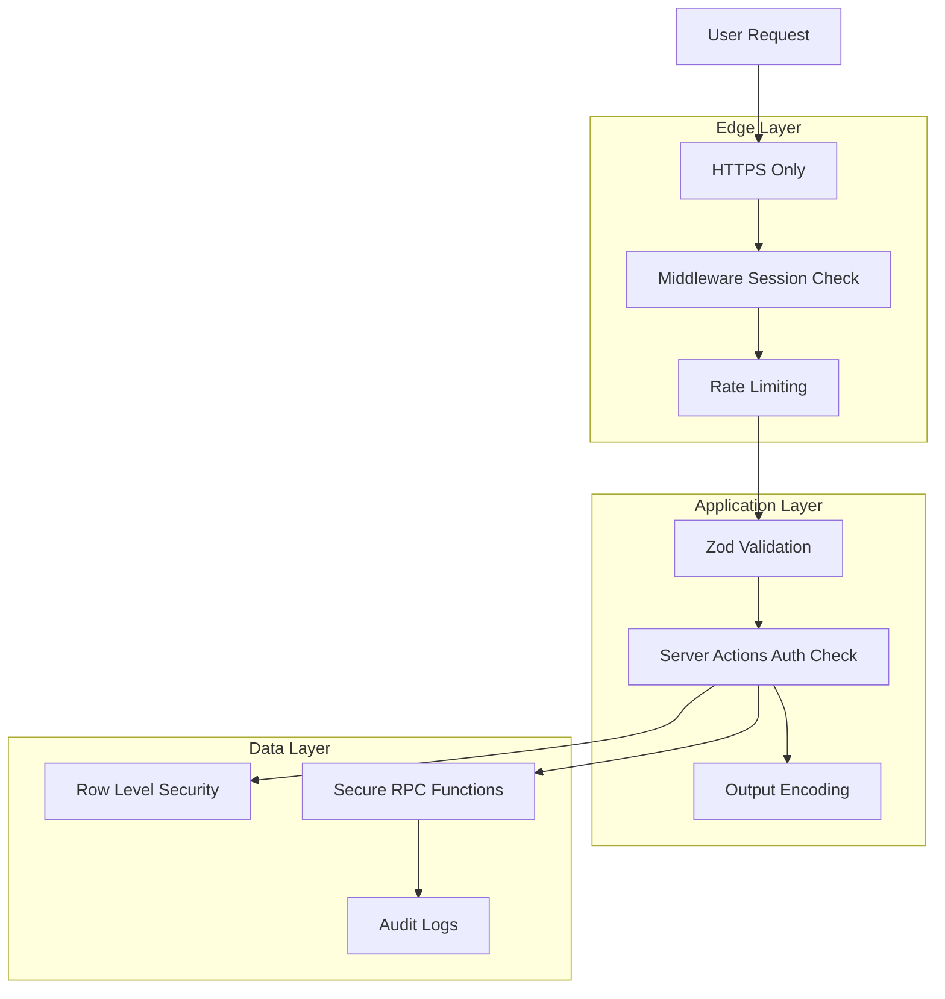

# Security

## Related Documents

- [Authentication](./07_AUTHENTICATION.md)
- [RBAC](./06_RBAC.md)
- [Database Design](./05_DATABASE_DESIGN.md)
- [API Strategy](./09_API_STRATEGY.md)
- [Deployment](./13_DEPLOYMENT.md)
- [Decisions](./18_DECISIONS.md)

---

## Overview

Security practices aligned with OWASP recommendations, adapted for a Next.js + Supabase modular monolith. Defense in depth: middleware session validation, Zod input validation, RLS authorization, and secure UI patterns.

---

## Security Architecture



---

## Authentication Security

| Control | Implementation |
|---------|----------------|
| Identity provider | Google OAuth via Supabase Auth (trusted IdP) |
| Password storage | N/A for MVP (OAuth only) |
| Session tokens | HttpOnly cookies via `@supabase/ssr` |
| JWT validation | Server uses `getUser()` — validates with Supabase |
| Session fixation | Supabase issues new tokens on OAuth exchange |
| Sign-out | Full session invalidation via `signOut()` |
| Future MFA | Supabase TOTP when enabled |

See [Authentication](./07_AUTHENTICATION.md).

---

## Authorization Security

| Control | Implementation |
|---------|----------------|
| Primary enforcement | Supabase RLS on all tables |
| Role model | Platform + community roles — [RBAC](./06_RBAC.md) |
| Least privilege | Default `member`; admin granted explicitly |
| RPC authorization | SECURITY DEFINER functions validate caller inside function |
| Service role isolation | Never in client, Server Actions, or Route Handlers for user requests |
| Super admin | Set via SQL only; no UI promotion in MVP |

---

## Input Validation

| Layer | Tool | Scope |
|-------|------|-------|
| Server Actions | Zod schemas | All mutation inputs |
| Forms | React Hook Form + Zod resolver | Client-side UX validation |
| Database | CHECK constraints, enums, FK | Structural integrity |
| URL params | Zod parse in page loaders | Slugs, UUIDs |

**Rules:**

- Reject unknown fields with `.strict()` where appropriate
- Validate UUIDs with `z.string().uuid()`
- Validate slugs with `z.string().regex(/^[a-z0-9-]+$/)`
- Capacity: `z.number().int().min(1).max(500)`
- Datetimes: ISO strings parsed to Date, validate `ends_at > starts_at`

Never trust client-only validation.

---

## Input Sanitization

| Vector | Mitigation |
|--------|------------|
| HTML in user text | React escapes by default; never use `dangerouslySetInnerHTML` for user content |
| SQL injection | Parameterized queries via Supabase client; no raw SQL in app code |
| Event description | Store as plain text; render as text, not HTML |
| File uploads (avatar) | Supabase Storage with MIME type allowlist (image/jpeg, image/png, image/webp); size limit 2MB |

---

## XSS (Cross-Site Scripting)

| Risk | Mitigation |
|------|------------|
| Stored XSS in event title/description | React text rendering; CSP headers |
| Reflected XSS in search/query | Zod validation; encode output |
| DOM XSS | Avoid `dangerouslySetInnerHTML`; sanitize if rich text added later |

### Content Security Policy (Future Hardening)

Add via `next.config.ts` headers in M17:

```
default-src 'self';
script-src 'self' 'unsafe-inline' 'unsafe-eval';
style-src 'self' 'unsafe-inline';
img-src 'self' data: https:;
connect-src 'self' https://*.supabase.co;
```

Start permissive for Next.js; tighten incrementally.

---

## CSRF (Cross-Site Request Forgery)

| Context | Mitigation |
|---------|------------|
| Server Actions | Next.js built-in origin verification for Server Actions |
| OAuth flow | Supabase state parameter |
| Cookie SameSite | `Lax` default prevents cross-site cookie on POST |
| API routes | Same-origin checks if added |

No custom CSRF tokens needed for Server Actions in Next.js 14+.

---

## SQL Injection

| Vector | Mitigation |
|--------|------------|
| Supabase client queries | Parameterized automatically |
| RPC functions | Typed parameters; no dynamic SQL from user input |
| Migrations | Developer-authored SQL only |

---

## Rate Limiting Strategy

MVP uses layered rate limiting:

| Endpoint / Action | Limit | Implementation |
|-------------------|-------|----------------|
| Google OAuth attempts | 10/min per IP | Vercel middleware or Supabase Auth built-in |
| `join_event` RPC | 5/min per user | Server Action check + Supabase rate limit |
| `leave_event` RPC | 10/min per user | Server Action check |
| Public event page | 100/min per IP | Vercel edge (optional) |
| Login page | 20/min per IP | Middleware counter (in-memory or Upstash future) |

**MVP implementation:** Server Action debounce + Supabase Auth rate limits. Document Upstash Redis for production hardening when traffic grows.

**Abuse response:** Return `429 Too Many Requests` with `{ code: 'RATE_LIMITED' }`.

---

## Secrets Management

| Secret | Storage | Never |
|--------|---------|-------|
| `NEXT_PUBLIC_SUPABASE_URL` | Vercel env (public) | — |
| `NEXT_PUBLIC_SUPABASE_ANON_KEY` | Vercel env (public) | — |
| `SUPABASE_SERVICE_ROLE_KEY` | Vercel env (production only, server scripts) | Client, git, logs |
| Google OAuth secrets | Supabase Dashboard | Application env |
| `.env.local` | Local dev only | Commit to git |

**`.gitignore` must include:** `.env`, `.env.local`, `.env*.local`

Rotate service role key if ever exposed.

---

## Environment Variables

See [Deployment](./13_DEPLOYMENT.md) for full matrix.

Validation at startup (M1):

```typescript
// src/lib/env.ts — validate with Zod
const envSchema = z.object({
  NEXT_PUBLIC_SUPABASE_URL: z.string().url(),
  NEXT_PUBLIC_SUPABASE_ANON_KEY: z.string().min(1),
  NEXT_PUBLIC_APP_URL: z.string().url(),
});
```

Fail fast on missing env in production build.

---

## Audit Logs

Sensitive admin actions write to `audit_logs`:

| Action | entity_type | metadata |
|--------|-------------|----------|
| `participant.removed` | event_participant | `{ event_id, profile_id }` |
| `event.cancelled` | event | `{ title }` |
| `community.updated` | community | `{ fields_changed }` |
| `attendance.marked` | attendance | `{ status }` |

Retention: indefinite for MVP; archive policy at scale.

Access: super admin only via RLS.

---

## Soft Deletes

| Entity | Field | Behavior |
|--------|-------|----------|
| profiles | deleted_at | User deactivated; auth disabled separately |
| communities | deleted_at | Hidden from lists; events inaccessible |
| events | deleted_at | Public page shows "Event not found" |

Soft delete preserves audit trail. Hard delete only via super admin scripts for GDPR erasure requests (future).

---

## Secure Cookies

Managed by Supabase SSR adapter:

- Production: `Secure` flag (HTTPS)
- `SameSite=Lax`
- Session cookies not accessible to JavaScript where HttpOnly supported

---

## Least Privilege

| Actor | Access |
|-------|--------|
| Browser client | Anon key + user JWT only |
| Server Components / Actions | Anon key + user session |
| Migration scripts (local CI) | Service role in CI secret only |
| Super admin UI | No service role; uses RLS super_admin policies |

---

## Session Security

| Threat | Mitigation |
|--------|------------|
| Token theft | Short JWT expiry, refresh rotation, HTTPS |
| Session on shared device | Sign out button prominent in settings |
| Concurrent sessions | Allowed (MVP); revoke all sessions future via Supabase |

---

## File Upload Security (Avatars)

| Control | Value |
|---------|-------|
| Storage bucket | `avatars` — public read, auth write own path |
| Path pattern | `{user_id}/avatar.{ext}` |
| Max size | 2 MB |
| Allowed types | image/jpeg, image/png, image/webp |
| RLS | User can upload/update only own folder |

---

## OWASP Top 10 Mapping (2021)

| Risk | Status | Mitigation |
|------|--------|------------|
| A01 Broken Access Control | Addressed | RLS + RBAC + RPC auth |
| A02 Cryptographic Failures | Addressed | HTTPS, Supabase managed crypto |
| A03 Injection | Addressed | Parameterized queries, Zod |
| A04 Insecure Design | Addressed | FCFS atomic RPC, threat modeling in docs |
| A05 Security Misconfiguration | Partial | Env validation, secure defaults; CSP future |
| A06 Vulnerable Components | Ongoing | Dependabot, `pnpm audit` in CI |
| A07 Auth Failures | Addressed | Supabase Auth, OAuth, session refresh |
| A08 Data Integrity Failures | Addressed | Server Actions origin check, signed OAuth |
| A09 Logging Failures | Partial | Audit logs; Sentry future |
| A10 SSRF | N/A | No user-controlled server-side fetch in MVP |

---

## Future MFA Support

When enabled in Supabase:

1. Enroll after primary auth in settings
2. Challenge on login for enrolled users
3. Backup codes stored by Supabase
4. No application password to manage

---

## Security Testing

| Test Type | Tool | Frequency |
|-----------|------|-----------|
| Dependency audit | `pnpm audit` | Every PR |
| RLS policy tests | SQL tests or Supabase test suite | M14 |
| E2E auth bypass attempts | Playwright | M16 |
| Manual penetration checklist | Documented below | M18 |

### Manual Security Checklist (M18)

- [ ] Unauthenticated user cannot access `/dashboard`
- [ ] Member cannot create event via direct Supabase client
- [ ] Member cannot join event in another community
- [ ] Direct INSERT to event_participants fails
- [ ] Service role key not in client bundle (`NEXT_PUBLIC_*` scan)
- [ ] OAuth redirect only to allowed URLs
- [ ] Rate limit triggers on rapid join attempts
- [ ] Soft-deleted event not visible on public page

---

## Incident Response (Minimal)

1. Rotate compromised keys in Supabase Dashboard
2. Redeploy Vercel with new env vars
3. Review audit_logs for affected period
4. Notify users if data breach (future policy)

---

## GDPR / Privacy Considerations (Future)

- Export user data: profile + participations
- Delete account: soft delete profile, anonymize participations
- Privacy policy and consent banner before production launch

Not blocking MVP development; document in roadmap.
