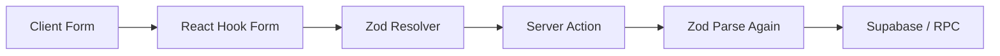

# API Strategy

## Related Documents

- [System Architecture](./04_SYSTEM_ARCHITECTURE.md)
- [Database Design](./05_DATABASE_DESIGN.md)
- [RBAC](./06_RBAC.md)
- [Security](./08_SECURITY.md)
- [Coding Standards](./14_CODING_STANDARDS.md)
- [Implementation Plan](./16_IMPLEMENTATION_PLAN.md)

---

## Overview

The MVP has **no separate REST API**. All server communication uses:

1. **Server Actions** — mutations (create, update, delete, join, leave)
2. **Server Components** — reads via Supabase server client in `queries.ts`
3. **Route Handlers** — only for OAuth callback edge cases if needed

This document catalogs every Server Action, query function, validation schema, and error contract.

**Future:** Public REST or GraphQL API for native apps — post-MVP.

---

## Design Principles

| Principle | Application |
|-----------|-------------|
| Validate everything | Zod at every action entry |
| Typed responses | `ActionResult<T>` union type |
| Idempotent where possible | Leave when not joined returns success |
| RPC for atomic ops | join/leave/remove via Supabase RPC |
| Revalidate after mutation | `revalidatePath` for affected routes |
| No service role in actions | User-scoped client only |

---

## Response Types

```typescript
// src/types/actions.ts

export type ActionError = {
  code: string;
  message: string;
  fieldErrors?: Record<string, string[]>;
};

export type ActionResult<T = void> =
  | { success: true; data: T }
  | { success: false; error: ActionError };
```

### Error Codes

| Code | HTTP Analog | When |
|------|-------------|------|
| `UNAUTHORIZED` | 401 | No session |
| `FORBIDDEN` | 403 | RLS or role denial |
| `NOT_FOUND` | 404 | Entity missing or soft-deleted |
| `VALIDATION_ERROR` | 400 | Zod failure |
| `CONFLICT` | 409 | Already joined, duplicate slug |
| `EVENT_FULL` | 409 | Returned as waitlisted, not error |
| `RATE_LIMITED` | 429 | Too many requests |
| `INTERNAL_ERROR` | 500 | Unexpected failure |

User-facing messages in `error.message` — never expose Postgres error text.

---

## Server Actions Catalog

### Auth (`src/features/auth/actions.ts`)

| Action | Input | Output | Milestone |
|--------|-------|--------|-----------|
| `signInWithGoogle` | `{ redirectTo?: string }` | Redirect | M3 |
| `signOut` | — | Redirect to `/login` | M3 |

`signInWithGoogle` calls `supabase.auth.signInWithOAuth({ provider: 'google', options: { redirectTo } })`.

---

### Profile (`src/features/auth/actions.ts` or `profile/actions.ts`)

| Action | Input Schema | Output | Milestone |
|--------|--------------|--------|-----------|
| `updateProfile` | `updateProfileSchema` | `ActionResult<Profile>`; saves profile fields and completes first-login onboarding | M4 |

```typescript
// src/lib/validations/profile.ts
export const updateProfileSchema = z.object({
  displayName: z.string().min(2).max(50).trim(),
  phone: z.string().regex(/^\+?[0-9]{10,15}$/).optional().or(z.literal('')),
  avatarUrl: z.string().url().optional(),
});
```

---

### Communities (`src/features/communities/actions.ts`)

| Action | Input Schema | Output | Milestone |
|--------|--------------|--------|-----------|
| `createCommunity` | `createCommunitySchema` | `ActionResult<Community>` | M5 |
| `updateCommunity` | `updateCommunitySchema` | `ActionResult<Community>` | M5 |

```typescript
export const createCommunitySchema = z.object({
  name: z.string().min(2).max(80).trim(),
  slug: z.string().min(2).max(40).regex(/^[a-z0-9-]+$/),
  description: z.string().max(500).optional(),
  activityTypeId: z.string().uuid(),
});
```

**MVP constraint:** Reject if user already owns a community (unless super admin).

---

### Events (`src/features/events/actions.ts`)

| Action | Input Schema | Output | Milestone |
|--------|--------------|--------|-----------|
| `createEvent` | `createEventSchema` | `ActionResult<Event>` | M6 |
| `updateEvent` | `updateEventSchema` | `ActionResult<Event>` | M6 |
| `publishEvent` | `{ eventId: uuid }` | `ActionResult<Event>` | M6 |
| `cancelEvent` | `{ eventId: uuid }` | `ActionResult<Event>` | M6 |

```typescript
export const createEventSchema = z.object({
  communityId: z.string().uuid(),
  title: z.string().min(3).max(100).trim(),
  description: z.string().max(2000).optional(),
  startsAt: z.string().datetime(),
  endsAt: z.string().datetime(),
  capacity: z.number().int().min(1).max(500),
  location: z.string().max(200).optional(),
  activityTypeId: z.string().uuid(),
}).refine(data => new Date(data.endsAt) > new Date(data.startsAt), {
  message: 'End time must be after start time',
  path: ['endsAt'],
});
```

`createEvent` generates `share_slug` via nanoid (8 chars, URL-safe).

---

### Participants (`src/features/participants/actions.ts`)

| Action | Input | Output | Milestone |
|--------|-------|--------|-----------|
| `joinEvent` | `{ eventId: uuid }` | `ActionResult<JoinResult>` | M8 |
| `leaveEvent` | `{ eventId: uuid }` | `ActionResult<LeaveResult>` | M10 |
| `removeParticipant` | `{ participantId: uuid }` | `ActionResult<LeaveResult>` | M11 |

```typescript
type JoinResult = {
  status: 'confirmed' | 'waitlisted';
  waitlistPosition: number | null;
};

type LeaveResult = {
  cancelled: true;
  promotedProfileId: string | null;
};
```

**Implementation:**

```typescript
const { data, error } = await supabase.rpc('join_event', {
  p_event_id: eventId,
});
```

Map Postgres exceptions to error codes:

| Postgres / RPC signal | Code |
|-----------------------|------|
| not community member | `FORBIDDEN` |
| already joined | `CONFLICT` |
| event not joinable | `NOT_FOUND` |

---

### Attendance (`src/features/attendance/actions.ts`)

| Action | Input Schema | Output | Milestone |
|--------|--------------|--------|-----------|
| `markAttendance` | `markAttendanceSchema` | `ActionResult<AttendanceRecord>` | M12 |
| `bulkMarkAttendance` | `bulkMarkAttendanceSchema` | `ActionResult<{ updated: number }>` | M12 |

```typescript
export const markAttendanceSchema = z.object({
  participantId: z.string().uuid(),
  status: z.enum(['present', 'absent', 'no_show']),
});
```

---

## Query Functions Catalog

Queries live in `src/features/*/queries.ts`. Use React `cache()` for deduplication within a request.

### Auth / Profile

| Function | Returns | Milestone |
|----------|---------|-----------|
| `getCurrentUser()` | User \| null | M3 |
| `getCurrentProfile()` | Profile \| null | M4 |

### Communities

| Function | Returns | Milestone |
|----------|---------|-----------|
| `getCommunityById(id)` | Community | M5 |
| `getCommunityForUser(userId)` | Community \| null | M5 |
| `getCommunityMembers(communityId)` | Member[] | M5 |

### Events

| Function | Returns | Milestone |
|----------|---------|-----------|
| `getEventBySlug(slug)` | EventWithCommunity | M7 |
| `getEventById(id)` | Event | M6 |
| `getUpcomingEvents(communityId)` | Event[] | M13 |
| `getEventWithCounts(eventId)` | Event + confirmed/waitlist counts | M7 |

### Participants

| Function | Returns | Milestone |
|----------|---------|-----------|
| `getConfirmedParticipants(eventId, page?)` | Participant[] | M11 |
| `getWaitlistedParticipants(eventId)` | Participant[] (admin only) | M11 |
| `getUserParticipation(eventId, userId)` | Participation \| null | M8 |

### Attendance

| Function | Returns | Milestone |
|----------|---------|-----------|
| `getAttendanceForEvent(eventId)` | AttendanceRecord[] | M12 |

---

## Route Handlers (Minimal)

| Route | Method | Purpose | Milestone |
|-------|--------|---------|-----------|
| `/auth/callback` | GET | OAuth code exchange (prefer page route) | M3 |

Prefer App Router page at `app/(auth)/auth/callback/route.ts` per Supabase SSR guide.

No public REST endpoints in MVP.

---

## Validation Strategy



Always re-validate on server. Client validation is UX only.

Schemas live in `src/lib/validations/` grouped by domain:

```
validations/
  profile.ts
  community.ts
  event.ts
  participant.ts
  attendance.ts
```

Export inferred types: `type CreateEventInput = z.infer<typeof createEventSchema>`.

---

## Optimistic UI

Safe for optimistic updates:

| Action | Optimistic Behavior |
|--------|---------------------|
| `joinEvent` | Show "Joining..." → confirm or show waitlist on response |
| `leaveEvent` | Disable button until response |

**Not optimistic:** Admin remove participant (wait for promotion result).

Use `useTransition` or `useOptimistic` (React 19) in Client Components.

---

## Pagination

```typescript
export const paginationSchema = z.object({
  page: z.number().int().min(1).default(1),
  pageSize: z.number().int().min(1).max(100).default(50),
});
```

Query pattern:

```typescript
const from = (page - 1) * pageSize;
const to = from + pageSize - 1;
supabase.from('event_participants').select('*').range(from, to);
```

---

## Revalidation Map

| Action | revalidatePath |
|--------|----------------|
| createEvent | `/dashboard`, `/dashboard/events` |
| joinEvent | `/e/[slug]`, `/dashboard/events/[id]` |
| leaveEvent | `/e/[slug]`, `/dashboard/events/[id]` |
| markAttendance | `/dashboard/events/[id]/attendance` |
| updateProfile | `/dashboard/settings` |

Use `revalidateTag('event-${eventId}')` if tag-based caching adopted.

---

## Future API Extensions

When native apps require a public API:

| Approach | Tradeoff |
|----------|----------|
| Next.js Route Handlers + API keys | Simple; same codebase |
| Supabase auto-generated REST | Fast; limited custom logic |
| tRPC router | Type-safe; new layer |

Recommend Route Handlers wrapping same Zod schemas and RPC calls — single business logic path.

---

## Webhooks (Future)

| Event | Endpoint |
|-------|----------|
| Stripe payment success | `/api/webhooks/stripe` |
| WhatsApp inbound | `/api/webhooks/whatsapp` |

Verify signatures; use service role sparingly with explicit checks.

---

## Action Implementation Template

```typescript
'use server';

import { createClient } from '@/lib/supabase/server';
import { createEventSchema } from '@/lib/validations/event';
import { revalidatePath } from 'next/cache';
import type { ActionResult } from '@/types/actions';

export async function createEvent(
  input: unknown
): Promise<ActionResult<Event>> {
  const parsed = createEventSchema.safeParse(input);
  if (!parsed.success) {
    return {
      success: false,
      error: {
        code: 'VALIDATION_ERROR',
        message: 'Invalid input',
        fieldErrors: parsed.error.flatten().fieldErrors,
      },
    };
  }

  const supabase = await createClient();
  const { data: { user } } = await supabase.auth.getUser();
  if (!user) {
    return { success: false, error: { code: 'UNAUTHORIZED', message: 'Sign in required' } };
  }

  try {
    const { data, error } = await supabase.from('events').insert({ ... }).select().single();
    if (error) throw error;
    revalidatePath('/dashboard/events');
    return { success: true, data };
  } catch (e) {
    console.error('[createEvent]', { userId: user.id, error: e });
    return { success: false, error: { code: 'INTERNAL_ERROR', message: 'Failed to create event' } };
  }
}
```

---

## Testing Server Actions

| Level | Approach |
|-------|----------|
| Unit | Test Zod schemas with Vitest |
| Integration | Mock Supabase client; test error mapping |
| E2E | Playwright exercises full join flow |

See [Testing](./12_TESTING.md).
