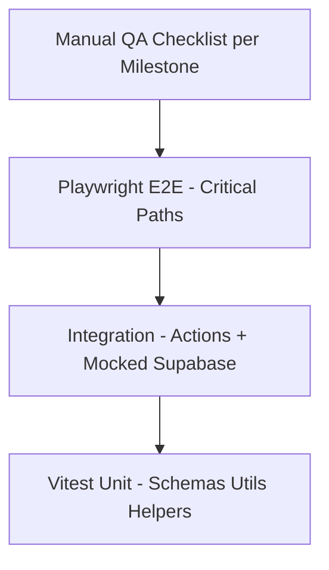

# Testing

## Related Documents

- [Requirements](./02_REQUIREMENTS.md)
- [API Strategy](./09_API_STRATEGY.md)
- [Security](./08_SECURITY.md)
- [RBAC](./06_RBAC.md)
- [Implementation Plan](./16_IMPLEMENTATION_PLAN.md)
- [Deployment](./13_DEPLOYMENT.md)

---

## Overview

Testing strategy for RallyNook using **Vitest** (unit/integration) and **Playwright** (E2E). Tests validate critical business rules: FCFS join, waitlist, auto-promotion, and RBAC.

---

## Testing Pyramid



| Layer | Tool | Coverage Target |
|-------|------|-----------------|
| Unit | Vitest | Zod schemas, utilities, role helpers |
| Integration | Vitest + mocks | Server Action error mapping |
| E2E | Playwright | Auth, join, waitlist, promotion, admin |
| Manual | Checklist | Every milestone before merge |
| A11y | axe-core in Playwright | Key pages |
| Performance | Lighthouse CI (optional M18) | Public event page |

---

## Unit Testing (Vitest)

### Setup (M16)

```
tests/
  unit/
    validations/
      event.test.ts
      profile.test.ts
    utils/
      slug.test.ts
      dates.test.ts
  setup.ts
vitest.config.ts
```

### What to Unit Test

| Target | Examples |
|--------|----------|
| Zod schemas | Invalid capacity, end before start, slug format |
| Utilities | `generateShareSlug`, `formatEventDate`, `getInitials` |
| Error mapping | Postgres code → ActionError code |
| Role helpers | `canManageEvent` logic (pure functions) |

### What NOT to Unit Test

- shadcn component rendering (unless custom logic)
- Supabase RLS (use SQL/integration tests)
- Trivial one-liners

### Example

```typescript
// tests/unit/validations/event.test.ts
import { describe, it, expect } from 'vitest';
import { createEventSchema } from '@/lib/validations/event';

describe('createEventSchema', () => {
  it('rejects end time before start time', () => {
    const result = createEventSchema.safeParse({
      communityId: '00000000-0000-4000-8000-000000000001',
      title: 'Tuesday Badminton',
      startsAt: '2026-07-01T18:00:00Z',
      endsAt: '2026-07-01T17:00:00Z',
      capacity: 16,
      activityTypeId: '00000000-0000-4000-8000-000000000002',
    });
    expect(result.success).toBe(false);
  });
});
```

### Commands

```bash
pnpm test           # Run all Vitest tests
pnpm test:watch     # Watch mode
pnpm test:coverage   # Coverage report
```

---

## Integration Testing

### Server Actions with Mocked Supabase

Mock `@/lib/supabase/server` to return controlled responses:

```typescript
vi.mock('@/lib/supabase/server', () => ({
  createClient: vi.fn(() => mockSupabaseClient),
}));
```

Test:

- Validation rejection before Supabase call
- Unauthorized when no user
- Error code mapping from Supabase errors
- Success path returns `{ success: true }`

### Database / RLS Tests (M14)

Option A: Supabase local with test seed data  
Option B: SQL tests run in CI against ephemeral branch

| Test | Assertion |
|------|-----------|
| Guest SELECT published event | Returns row |
| Guest INSERT participant | Denied |
| Member join via RPC | Confirmed or waitlisted |
| Admin remove participant | Success + promotion |

---

## End-to-End Testing (Playwright)

### Setup (M16)

```
tests/
  e2e/
    auth.spec.ts
    join-event.spec.ts
    waitlist-promotion.spec.ts
    admin-attendance.spec.ts
  fixtures/
    auth.setup.ts
playwright.config.ts
```

### Configuration

```typescript
// playwright.config.ts highlights
export default defineConfig({
  testDir: './tests/e2e',
  fullyParallel: true,
  retries: process.env.CI ? 2 : 0,
  use: {
    baseURL: process.env.PLAYWRIGHT_BASE_URL || 'http://localhost:3000',
    trace: 'on-first-retry',
  },
  projects: [
    { name: 'setup', testMatch: /auth.setup.ts/ },
    { name: 'chromium', dependencies: ['setup'], use: { storageState: 'tests/.auth/user.json' } },
  ],
});
```

### Critical E2E Flows

#### 1. Authentication (`auth.spec.ts`)

| Step | Action | Expected |
|------|--------|----------|
| 1 | Visit `/dashboard` unauthenticated | Redirect to `/login` |
| 2 | Complete Google OAuth (test account) | Land on dashboard |
| 3 | Sign out | Redirect to login |
| 4 | Visit `/e/test-slug` | Public page loads without auth |

**Note:** This project uses Auth0 with Google as the configured connection; it does not manage application passwords. For local authenticated E2E, complete the real Auth0 Google login once, save Playwright storage state to `tests/.auth/user.json`, and set `PLAYWRIGHT_STORAGE_STATE` in the ignored `.env.test`. Never commit credentials or storage state.

#### 2. Join Event FCFS (`join-event.spec.ts`)

| Step | Action | Expected |
|------|--------|----------|
| 1 | Open published event with capacity | Join button visible |
| 2 | Click Join | Status confirmed, count +1 |
| 3 | Refresh page | Still confirmed |

#### 3. Waitlist and Promotion (`waitlist-promotion.spec.ts`)

| Step | Action | Expected |
|------|--------|----------|
| 1 | Fill event to capacity (seed or loop) | Event full |
| 2 | Join as new user | Waitlisted with position |
| 3 | Confirmed user leaves | Waitlisted user promoted |
| 4 | Refresh waitlisted user page | Now confirmed |

#### 4. Admin Attendance (`admin-attendance.spec.ts`)

| Step | Action | Expected |
|------|--------|----------|
| 1 | Admin opens event attendance tab | Participant list |
| 2 | Mark present | Badge updates |
| 3 | Member cannot access admin mark | Button not visible |

### Commands

```bash
pnpm exec playwright install   # Install browsers (once)
pnpm e2e                       # Run E2E tests
pnpm e2e:ui                    # Playwright UI mode
```

---

## Accessibility Testing

### Automated

Use `@axe-core/playwright` on key pages:

```typescript
import AxeBuilder from '@axe-core/playwright';

test('public event page a11y', async ({ page }) => {
  await page.goto('/e/test-event-slug');
  const results = await new AxeBuilder({ page }).analyze();
  expect(results.violations).toEqual([]);
});
```

**Pages to scan:** Login, public event, dashboard, create event form.

### Manual A11y Checklist

- [ ] Tab through all interactive elements in logical order
- [ ] Focus ring visible on all controls
- [ ] Screen reader announces join status changes (live region)
- [ ] Color contrast passes (dark and light)
- [ ] Form errors linked via aria-describedby
- [ ] Icon-only buttons have aria-label
- [ ] Reduced motion disables animations

---

## Performance Testing

### MVP Targets

| Metric | Target | Tool |
|--------|--------|------|
| LCP (public event mobile) | < 2.5s | Lighthouse |
| Join action response | < 500ms p95 | Manual + Vercel logs |
| Bundle size (first load) | < 200KB JS | `@next/bundle-analyzer` |

### Lighthouse CI (M18 optional)

Run on PR for `/e/[slug]` route in mobile emulation.

---

## Manual QA Checklist (MVP Launch)

### Authentication

- [ ] Google sign-in works on mobile Safari and Chrome — requires device verification
- [ ] Session persists after browser restart
- [ ] Protected routes redirect correctly
- [ ] Sign out clears session

### Events

- [ ] Admin creates event with all fields
- [x] Published demo share URL opens correctly
- [x] Public page shows without login
- [ ] Draft events not publicly visible
- [ ] Cancelled event shows appropriate message

### Join / Waitlist

- [ ] FCFS order preserved under rapid joins — requires authenticated browser session
- [ ] Capacity never exceeded
- [ ] Waitlist position accurate
- [ ] Auto-promotion on leave immediate
- [ ] Admin remove triggers promotion

### RBAC

- [ ] Member cannot create events
- [ ] Member cannot see others' waitlist position
- [ ] Admin sees full waitlist
- [ ] Guest cannot join

### UI

- [x] Dark mode default is configured; light toggle is implemented
- [x] Public event renders at 375px and 1440px
- [ ] Empty states display correctly
- [ ] Loading states on all async actions
- [ ] Error toasts on failures

### Cross-Browser

- [ ] Chrome (Android) — requires device verification
- [ ] Safari (iOS)
- [ ] Chrome (desktop)
- [ ] Firefox (desktop)

---

## CI Integration (M17)

```yaml
# .github/workflows/ci.yml (documented in Deployment)
jobs:
  test:
    runs-on: ubuntu-latest
    steps:
      - uses: actions/checkout@v4
      - uses: pnpm/action-setup@v4
      - run: pnpm install
      - run: pnpm lint
      - run: pnpm typecheck
      - run: pnpm test
      # E2E optional on PR; required on main
```

---

## Test Data Strategy

### Local Development

- Supabase seed script with test community, events, users
- `pnpm exec supabase db reset` loads seed

### E2E

- Dedicated test Supabase project or local Supabase
- Test users: `admin@test.local`, `member1@test.local`, etc.
- Events with known slugs: `e2e-open-event`, `e2e-full-event`

Never run E2E against production.

---

## Regression Prevention

1. Run `pnpm lint && pnpm typecheck && pnpm test` before every milestone commit
2. E2E must pass before M18 completion
3. Do not skip tests when fixing bugs — add test for the bug
4. Milestone acceptance criteria in [Implementation Plan](./16_IMPLEMENTATION_PLAN.md) includes test checklist

---

## Related Milestones

| Milestone | Testing Deliverable |
|-----------|---------------------|
| M14 | RLS policy verification |
| M16 | Vitest + Playwright setup, core E2E |
| M17 | CI pipeline |
| M18 | Full manual QA, optional Lighthouse |
