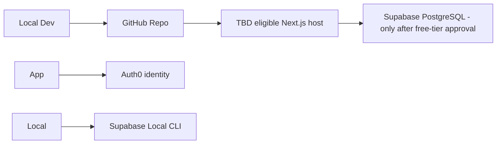
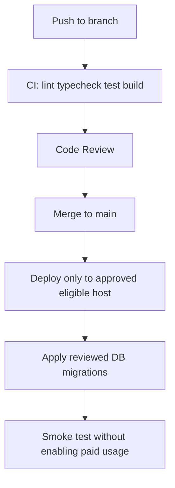

# Deployment

## Related Documents

- [System Architecture](./04_SYSTEM_ARCHITECTURE.md)
- [Security](./08_SECURITY.md)
- [Authentication](./07_AUTHENTICATION.md)
- [Testing](./12_TESTING.md)
- [Implementation Plan](./16_IMPLEMENTATION_PLAN.md)

---

## Overview

Run and test the Next.js application locally without paid services. Auth0 is the intended identity provider and Supabase PostgreSQL is the database candidate; hosted deployment is not approved until terms, payment requirements, quotas, and product eligibility are verified. See [Repository Audit](./19_REPOSITORY_AUDIT.md). Never enable billing or paid resources without explicit authorization.

---

## Infrastructure Diagram



---

## Supabase Setup

### 1. Local first; hosted project deferred

| Environment | Purpose |
|-------------|---------|
| Hosted | Do not create until payment/card, pause, quota, backup, and recovery requirements are verified |
| Local | `supabase start` for development |

### 2. Configure Auth0 integration

1. Configure Google as an Auth0 social connection; do not enable Supabase Auth.
2. Configure Supabase's Auth0 third-party integration using the current official guide.
3. Add the required Auth0 Action claim and validate it against the Supabase integration.
4. Set exact callback/logout URLs from the current Auth0 SDK documentation.
5. Keep Auth0 client/session secrets server-side. Do not provision a hosted DB or paid feature merely to complete setup.

### 3. Run Migrations

```bash
# Link local to remote project
supabase link --project-ref <project-id>

# Push migrations
supabase db push

# Or apply via Dashboard SQL editor for first deploy
```

Migration files: `supabase/migrations/*.sql`

### 4. Seed Data

```bash
supabase db seed
```

Seeds `activity_types`: badminton, pickleball, general.

### 5. Storage Bucket (M4)

Create bucket `avatars`:

- Public: true (read)
- RLS: authenticated users upload to `{user_id}/*`
- Max file size: 2MB
- Allowed MIME: image/jpeg, image/png, image/webp

---

## Hosting evaluation

Vercel Hobby is a candidate only for eligible personal, non-commercial use; its official fair-use restriction does not establish eligibility for this product. Do not select it for production until actual project use fits its terms. Evaluate an alternative host using the same free-tier, runtime, data persistence, and cost criteria in the audit. Do not enable usage-based billing.

### Vercel (conditional only)

1. Connect the GitHub repo only after confirming Hobby eligibility and plan restrictions
2. Framework preset: Next.js
3. Package manager: pnpm

### 2. Build Settings

| Setting | Value |
|---------|-------|
| Build command | `pnpm build` |
| Output directory | `.next` (default) |
| Install command | `pnpm install` |
| Node version | 20.x |

### 3. Environment Variables

Set in Vercel Dashboard for Production, Preview, and Development:

| Variable | Production | Preview | Development | Secret |
|----------|------------|---------|-------------|--------|
| `AUTH0_DOMAIN` | Tenant domain | Development tenant | Local dev tenant | No |
| `AUTH0_CLIENT_ID` | App client ID | Development app | Local dev app | No |
| `AUTH0_CLIENT_SECRET` | Secret | Secret | Secret | **Yes** |
| `AUTH0_SECRET` | Secret | Secret | Secret | **Yes** |
| `APP_BASE_URL` | Production URL | Preview URL | `http://localhost:3000` | No |
| `NEXT_PUBLIC_SUPABASE_URL` | Only after hosted DB approval | Only after staging approval | Local | No |
| `NEXT_PUBLIC_SUPABASE_ANON_KEY` | Only after hosted DB approval | Only after staging approval | Local | No |

**Never** prefix service role with `NEXT_PUBLIC_`.

### 4. Custom Domain (Optional)

1. Vercel → Project → Domains
2. Add domain, configure DNS
3. Update Auth0 callback/logout URLs
4. Set `APP_BASE_URL` to the canonical URL

---

## Local Development

### Prerequisites

- Node.js 20+
- pnpm 9+
- Supabase CLI
- Docker (for local Supabase)

### Setup Steps (M0–M1)

```bash
# Clone repo
git clone <repo-url>
cd sports-community-app

# Install dependencies
pnpm install

# Copy environment template
cp .env.example .env.local

# Start local Supabase (requires Docker)
supabase start

# Apply migrations and seed
supabase db reset

# Run database/RLS regression tests
supabase test db

# Start Next.js (Auth0 credentials required only for live sign-in)
pnpm dev
```

### `.env.example`

```env
AUTH0_DOMAIN=
AUTH0_CLIENT_ID=
AUTH0_CLIENT_SECRET=
AUTH0_SECRET=
APP_BASE_URL=http://localhost:3000
NEXT_PUBLIC_SUPABASE_URL=http://127.0.0.1:54321
NEXT_PUBLIC_SUPABASE_ANON_KEY=<local-publishable-key>
```

Use local Supabase CLI output for the publishable key and local database credentials. Never use a service-role key in user-facing application paths. Unit/build checks must work without hosted credentials; a live Auth0 login needs a configured Auth0 tenant.

---

## Deployment Workflow



### Branch Strategy

| Branch | Deploy Target |
|--------|---------------|
| `main` | Production only after host approval |
| `feature/*` | Preview only if covered by an approved free plan |
| `milestone/*` | Local validation by default |

### Database Migrations on Deploy

1. Verify migrations against local PostgreSQL/Supabase first.
2. Use a hosted staging project only after the free-tier and recovery review.
3. Merge only after migration and RLS tests pass.
4. Apply production migrations only after hosted production approval.
5. Prefer backward-compatible migrations (expand-contract pattern).

---

## CI/CD Pipeline (M17)

Create `.github/workflows/ci.yml`:

```yaml
name: CI

on:
  push:
    branches: [main]
  pull_request:
    branches: [main]

jobs:
  quality:
    runs-on: ubuntu-latest
    steps:
      - uses: actions/checkout@v4

      - uses: pnpm/action-setup@v4
        with:
          version: 9

      - uses: actions/setup-node@v4
        with:
          node-version: 20
          cache: 'pnpm'

      - run: pnpm install --frozen-lockfile
      - run: pnpm lint
      - run: pnpm typecheck
      - run: pnpm test

  e2e:
    runs-on: ubuntu-latest
    needs: quality
    if: github.ref == 'refs/heads/main'
    steps:
      - uses: actions/checkout@v4
      - uses: pnpm/action-setup@v4
      - uses: actions/setup-node@v4
        with:
          node-version: 20
          cache: 'pnpm'
      - run: pnpm install --frozen-lockfile
      - run: pnpm exec playwright install --with-deps chromium
      - run: pnpm build
      - run: pnpm e2e
```

E2E must use deterministic auth/database mocks by default and need no cloud credentials. Do not add paid runners or secrets-dependent provider smoke tests as a required check.

---

## Production Checklist (M17–M18)

### Before Launch

- [ ] Hosted database and deployment provider passed current free-tier, payment, terms, pause, backup, and recovery review
- [ ] All migrations applied to production
- [ ] Auth0 Google connection and production callback/logout URLs verified
- [ ] Deployment host is eligible under its current commercial-use terms
- [ ] Custom domain configured (if applicable)
- [ ] No service-role key is used in user-facing code or bundled for the client
- [ ] Super admin bootstrapped via SQL
- [ ] Seed activity types in production
- [ ] Storage bucket and RLS configured
- [ ] Smoke test: sign in, create event, join, leave, promote

### Post-Launch Monitoring

- Approved host metrics only, with no unverified paid analytics
- Supabase Dashboard: monitor DB size, auth users, API requests
- Error logging review first 48 hours

---

## Rollback Procedure

### Application Rollback

1. Use the approved host's documented rollback path.
2. Verify rollback does not require a paid capability or destructive database reversal.

### Database Rollback

1. Prefer forward-fix migration over rollback
2. If must rollback: apply down migration (maintain down scripts for critical migrations)
3. Never rollback after destructive schema change without backup

### Database recovery

- Do not assume the Supabase Free tier includes managed backups; its current free plan and recovery behavior must be verified.
- Before a major migration, create an export with the documented CLI/database tools and test restoring it locally.
- Record hosted backup, retention, and restore behavior in [Repository Audit](./19_REPOSITORY_AUDIT.md) before production use.

---

## Environment Variable Reference

| Variable | Required | Description |
|----------|----------|-------------|
| `NEXT_PUBLIC_SUPABASE_URL` | Yes | Supabase API URL |
| `NEXT_PUBLIC_SUPABASE_ANON_KEY` | Yes | Public anon key (RLS enforced) |
| `APP_BASE_URL` | Yes | Canonical app URL for Auth0 redirects |
| `AUTH0_DOMAIN` | Yes | Auth0 tenant domain |
| `AUTH0_CLIENT_ID` | Yes | Auth0 application ID |
| `AUTH0_CLIENT_SECRET` | Yes | Server-only Auth0 secret |
| `AUTH0_SECRET` | Yes | Server-only SDK session secret |
| `SUPABASE_SERVICE_ROLE_KEY` | Local/CI only | Bypasses RLS; server scripts only |

Validate at build time in `src/lib/env.ts`.

---

## Free Tier Limits (Monitor)

See dated quotas, restrictions, payment requirements, and sources in [Repository Audit](./19_REPOSITORY_AUDIT.md). Do not hardcode provider quotas in application behavior; re-verify before deployment. Never upgrade or accept overages without explicit authorization.

If free limits no longer fit, stop and document the limitation; a paid upgrade requires explicit authorization.

---

## Related Milestones

| Milestone | Deliverable |
|-----------|-------------|
| M1 | Local Supabase project + env.local |
| M17 | Approved free-tier deployment + CI |
| M18 | Production launch checklist |
