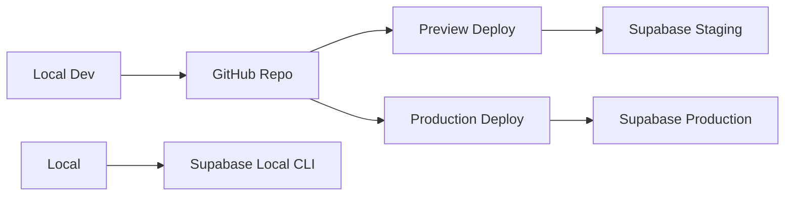
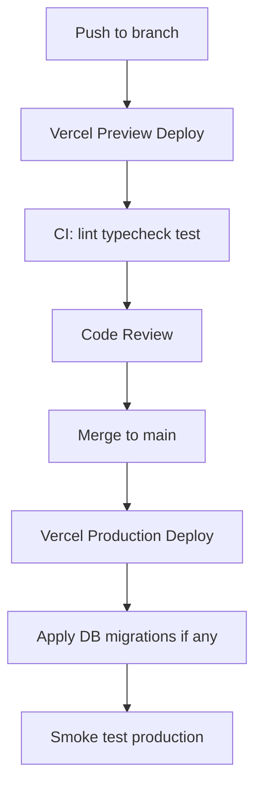

# Deployment

## Related Documents

- [System Architecture](./04_SYSTEM_ARCHITECTURE.md)
- [Security](./08_SECURITY.md)
- [Authentication](./07_AUTHENTICATION.md)
- [Testing](./12_TESTING.md)
- [Implementation Plan](./16_IMPLEMENTATION_PLAN.md)

---

## Overview

Deploy the Next.js application to **Vercel** and the database to **Supabase**. MVP runs entirely on free tiers. This document covers environment setup, deployment workflow, and CI/CD.

---

## Infrastructure Diagram



---

## Supabase Setup

### 1. Create Projects

| Environment | Purpose |
|-------------|---------|
| Production | Live users |
| Staging (optional) | Preview deploys and E2E |
| Local | `supabase start` for development |

### 2. Enable Google Auth

1. Supabase Dashboard → Authentication → Providers → Google
2. Add Google OAuth Client ID and Secret from Google Cloud Console
3. Configure redirect URLs

### 3. Run Migrations

```bash
# Link local to remote project
supabase link --project-ref <project-id>

# Push migrations
supabase db push

# Or apply via Dashboard SQL editor for first deploy
```

Migration files: `supabase/migrations/*.sql`

### 4. Seed Data

```bash
supabase db seed
```

Seeds `activity_types`: badminton, pickleball, general.

### 5. Storage Bucket (M4)

Create bucket `avatars`:

- Public: true (read)
- RLS: authenticated users upload to `{user_id}/*`
- Max file size: 2MB
- Allowed MIME: image/jpeg, image/png, image/webp

---

## Vercel Setup

### 1. Import Repository

1. Connect GitHub repo to Vercel
2. Framework preset: Next.js
3. Package manager: pnpm

### 2. Build Settings

| Setting | Value |
|---------|-------|
| Build command | `pnpm build` |
| Output directory | `.next` (default) |
| Install command | `pnpm install` |
| Node version | 20.x |

### 3. Environment Variables

Set in Vercel Dashboard for Production, Preview, and Development:

| Variable | Production | Preview | Development | Secret |
|----------|------------|---------|-------------|--------|
| `NEXT_PUBLIC_SUPABASE_URL` | Prod URL | Staging URL | Local | No |
| `NEXT_PUBLIC_SUPABASE_ANON_KEY` | Prod anon | Staging anon | Local | No |
| `NEXT_PUBLIC_APP_URL` | `https://yourdomain.com` | Preview URL | `http://localhost:3000` | No |
| `SUPABASE_SERVICE_ROLE_KEY` | Prod (CI only if needed) | Staging | Local | **Yes** |

**Never** prefix service role with `NEXT_PUBLIC_`.

### 4. Custom Domain (Optional)

1. Vercel → Project → Domains
2. Add domain, configure DNS
3. Update Google OAuth authorized origins
4. Update Supabase redirect URLs
5. Set `NEXT_PUBLIC_APP_URL` to custom domain

---

## Local Development

### Prerequisites

- Node.js 20+
- pnpm 9+
- Supabase CLI
- Docker (for local Supabase)

### Setup Steps (M0–M1)

```bash
# Clone repo
git clone <repo-url>
cd sports-community-app

# Install dependencies
pnpm install

# Copy environment template
cp .env.example .env.local

# Start local Supabase
supabase start

# Apply migrations and seed
supabase db reset

# Start Next.js
pnpm dev
```

### `.env.example`

```env
NEXT_PUBLIC_SUPABASE_URL=http://127.0.0.1:54321
NEXT_PUBLIC_SUPABASE_ANON_KEY=<local-anon-key>
NEXT_PUBLIC_APP_URL=http://localhost:3000
SUPABASE_SERVICE_ROLE_KEY=<local-service-role-key>
```

Copy anon and service role keys from `supabase start` output.

---

## Deployment Workflow



### Branch Strategy

| Branch | Deploy Target |
|--------|---------------|
| `main` | Production |
| `feature/*` | Preview URL per PR |
| `milestone/*` | Preview (optional) |

### Database Migrations on Deploy

1. Apply migrations to staging first
2. Verify preview deploy against staging Supabase
3. Merge PR
4. Apply migrations to production **before** or **with** production deploy
5. Backward-compatible migrations only (expand-contract pattern)

---

## CI/CD Pipeline (M17)

Create `.github/workflows/ci.yml`:

```yaml
name: CI

on:
  push:
    branches: [main]
  pull_request:
    branches: [main]

jobs:
  quality:
    runs-on: ubuntu-latest
    steps:
      - uses: actions/checkout@v4

      - uses: pnpm/action-setup@v4
        with:
          version: 9

      - uses: actions/setup-node@v4
        with:
          node-version: 20
          cache: 'pnpm'

      - run: pnpm install --frozen-lockfile
      - run: pnpm lint
      - run: pnpm typecheck
      - run: pnpm test

  e2e:
    runs-on: ubuntu-latest
    needs: quality
    if: github.ref == 'refs/heads/main'
    steps:
      - uses: actions/checkout@v4
      - uses: pnpm/action-setup@v4
      - uses: actions/setup-node@v4
        with:
          node-version: 20
          cache: 'pnpm'
      - run: pnpm install --frozen-lockfile
      - run: pnpm exec playwright install --with-deps chromium
      - run: pnpm build
      - run: pnpm e2e
        env:
          NEXT_PUBLIC_SUPABASE_URL: ${{ secrets.SUPABASE_STAGING_URL }}
          NEXT_PUBLIC_SUPABASE_ANON_KEY: ${{ secrets.SUPABASE_STAGING_ANON_KEY }}
          NEXT_PUBLIC_APP_URL: http://localhost:3000
```

Adjust E2E secrets per staging project setup.

---

## Production Checklist (M17–M18)

### Before Launch

- [ ] Production Supabase project created
- [ ] All migrations applied to production
- [ ] Google OAuth configured with production URLs
- [ ] Vercel env vars set for production
- [ ] Custom domain configured (if applicable)
- [ ] `SUPABASE_SERVICE_ROLE_KEY` not in client bundle
- [ ] Super admin bootstrapped via SQL
- [ ] Seed activity types in production
- [ ] Storage bucket and RLS configured
- [ ] Smoke test: sign in, create event, join, leave, promote

### Post-Launch Monitoring

- Vercel Analytics enabled
- Supabase Dashboard: monitor DB size, auth users, API requests
- Error logging review first 48 hours

---

## Rollback Procedure

### Application Rollback

1. Vercel Dashboard → Deployments → Previous deployment → Promote to Production
2. Instant rollback; no database change

### Database Rollback

1. Prefer forward-fix migration over rollback
2. If must rollback: apply down migration (maintain down scripts for critical migrations)
3. Never rollback after destructive schema change without backup

### Supabase Backups

- Free tier: daily backups (7 day retention on Pro; verify free tier limits)
- Before major migrations: manual dump via `supabase db dump`

---

## Environment Variable Reference

| Variable | Required | Description |
|----------|----------|-------------|
| `NEXT_PUBLIC_SUPABASE_URL` | Yes | Supabase API URL |
| `NEXT_PUBLIC_SUPABASE_ANON_KEY` | Yes | Public anon key (RLS enforced) |
| `NEXT_PUBLIC_APP_URL` | Yes | Canonical app URL for OAuth |
| `SUPABASE_SERVICE_ROLE_KEY` | Local/CI only | Bypasses RLS; server scripts only |

Validate at build time in `src/lib/env.ts`.

---

## Free Tier Limits (Monitor)

| Service | Free Tier Limit | Mitigation |
|---------|-----------------|------------|
| Vercel | 100GB bandwidth, serverless limits | Optimize images, cache public pages |
| Supabase | 500MB DB, 50K MAU auth | Monitor user growth |
| Google OAuth | Free | — |

Upgrade triggers documented in [Roadmap](./17_ROADMAP.md).

---

## Related Milestones

| Milestone | Deliverable |
|-----------|-------------|
| M1 | Supabase project + env.local |
| M17 | Vercel deploy + CI |
| M18 | Production launch checklist |
