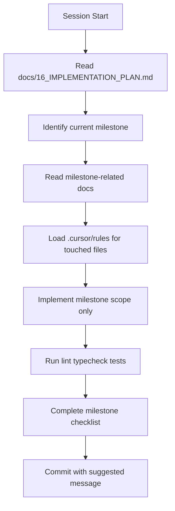
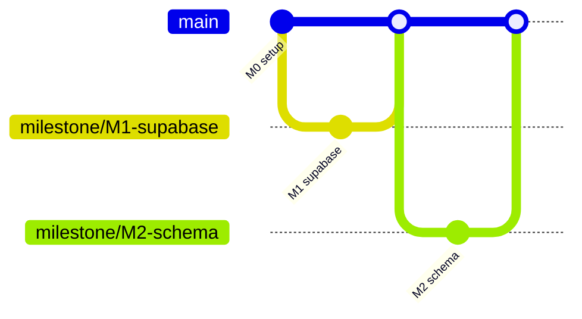

# AI Development Guide

## Related Documents

- [Implementation Plan](./16_IMPLEMENTATION_PLAN.md)
- [Coding Standards](./14_CODING_STANDARDS.md)
- [System Architecture](./04_SYSTEM_ARCHITECTURE.md)
- [Decisions](./18_DECISIONS.md)
- [Testing](./12_TESTING.md)

---

## Overview

This repository is designed for **AI-first development**. Nearly all application code will be generated by AI coding assistants (Cursor, Copilot, etc.) guided by documentation in `docs/` and rules in `.cursor/rules/`.

This guide ensures consistent, safe, milestone-driven implementation.

---

## Golden Rules for AI Sessions

1. **Read before writing** — Always read the current milestone in [Implementation Plan](./16_IMPLEMENTATION_PLAN.md) and related docs before generating code.
2. **One milestone at a time** — Do not skip ahead or implement future features.
3. **No scope creep** — Do not add court booking, payments, or notifications unless the milestone requires it.
4. **Working increments** — Each milestone must produce a runnable, testable application state.
5. **Follow docs over inference** — If docs conflict with training data, docs win.
6. **Run quality checks** — `pnpm lint && pnpm typecheck && pnpm test` before marking done.
7. **No placeholders** — No `TODO`, `FIXME`, or stub implementations in committed code.

---

## Session Start Protocol

Every AI session should begin with this workflow:



### Step 1: Identify Current Milestone

Check git history, README progress section, or ask user. Find first incomplete milestone M0–M18.

### Step 2: Load Context Documents

| Milestone Type | Required Reading |
|----------------|------------------|
| Any | `16_IMPLEMENTATION_PLAN.md` (current milestone section) |
| Database | `05_DATABASE_DESIGN.md`, `06_RBAC.md` |
| Auth | `07_AUTHENTICATION.md`, `08_SECURITY.md` |
| UI | `10_UI_SYSTEM.md`, `11_COMPONENT_LIBRARY.md` |
| Actions | `09_API_STRATEGY.md`, `14_CODING_STANDARDS.md` |
| Deploy | `13_DEPLOYMENT.md` |

### Step 3: Confirm Scope

State aloud (in response): milestone ID, features, files to create, acceptance criteria.

---

## Prompting Strategy

### Effective Prompts

**Good:**

```
Implement Milestone M8 (Join Event FCFS) per docs/16_IMPLEMENTATION_PLAN.md.
Read docs/05_DATABASE_DESIGN.md for join_event RPC and docs/09_API_STRATEGY.md for joinEvent action.
Do not implement waitlist UI beyond basic status display (that's M9).
Run lint and typecheck when done.
```

**Bad:**

```
Build the whole app
Add join functionality and payments
Make it look nice
```

### Prompt Templates

#### Start Milestone

```
Implement Milestone {ID} ({Name}) from docs/16_IMPLEMENTATION_PLAN.md.

Before coding:
1. Read the milestone section completely
2. Read cross-referenced docs listed in that section
3. List files you will create/modify

Constraints:
- Server Components by default
- Zod validation on all actions
- RLS enforced; use RPC for join/leave
- Match docs/10_UI_SYSTEM.md tokens
- Do not implement features from later milestones

When done:
- Run pnpm lint && pnpm typecheck
- Complete the milestone manual test checklist
- Suggest commit message from the plan
```

#### Fix Bug

```
Bug: {description}
Expected: {from acceptance criteria}
Actual: {what happens}

Read relevant docs before fixing. Add a test if M16+ is complete.
Do not refactor unrelated code.
```

#### Review Completed Work

```
Review implementation against Milestone {ID} acceptance criteria in docs/16_IMPLEMENTATION_PLAN.md.
Check RBAC alignment with docs/06_RBAC.md.
List any gaps or contradictions with docs.
```

---

## Context Strategy

### Priority Order (when context is limited)

1. Current milestone section in `16_IMPLEMENTATION_PLAN.md`
2. Relevant feature requirements in `02_REQUIREMENTS.md`
3. Database schema + RLS for data milestones
4. API Strategy for action milestones
5. UI System + Component Library for UI milestones
6. Coding Standards always applies

### Files to @ Mention in Cursor

| Task | Mention |
|------|---------|
| Join event | `@docs/16_IMPLEMENTATION_PLAN.md` `@docs/05_DATABASE_DESIGN.md` `@docs/09_API_STRATEGY.md` |
| RLS policies | `@docs/06_RBAC.md` `@docs/05_DATABASE_DESIGN.md` |
| Event page UI | `@docs/11_COMPONENT_LIBRARY.md` `@docs/10_UI_SYSTEM.md` |
| Auth | `@docs/07_AUTHENTICATION.md` `@docs/08_SECURITY.md` |

### Do Not Load

- Entire `docs/` folder at once (conflicts and noise)
- Deprecated or superseded ADRs without checking status
- Application code from unrelated features when doing isolated milestone

---

## Repository Workflow



### Branch Naming

`milestone/M{N}-{short-name}` — e.g., `milestone/M8-join-event`

### Workflow Steps

1. Create branch from `main`
2. Implement milestone
3. Run quality checks
4. Complete manual test checklist
5. Commit with conventional message from plan
6. Merge to `main` (PR if collaborating)

---

## Git Workflow

### Commit Frequency

One milestone may have multiple commits, but prefer squashing to one commit per milestone for clarity:

```
feat(participants): implement FCFS join event (M8)
```

### What to Commit

- Application code for milestone
- Migration files for schema milestones
- Test files when milestone includes testing
- **Do not** commit `.env.local`, secrets, or `node_modules`

### What NOT to Commit

- Partial next-milestone features
- Commented-out experimental code
- Unrelated formatting changes across codebase

---

## Code Review Workflow

For solo dev + AI, self-review checklist:

- [ ] Matches milestone acceptance criteria exactly
- [ ] No `any` types introduced
- [ ] No service role key in client/server action paths
- [ ] Zod validation on new actions
- [ ] RLS policies for new tables
- [ ] Dark and light mode work
- [ ] Mobile layout checked at 375px
- [ ] No hardcoded colors outside tokens
- [ ] No court booking logic introduced
- [ ] Docs updated if milestone says so (M18 only)

Optional: Use Cursor Bugbot or Security Review skills on PRs.

---

## Regression Prevention

### Before Every Commit

```bash
pnpm lint
pnpm typecheck
pnpm test        # after M16
```

### After Milestone Merge

Manually run previous milestone smoke tests:

- Auth still works
- Existing events still load
- Join/leave still atomic

### Test on Merge

When fixing bugs, add regression test:

```
// tests/unit/validations/event.test.ts
it('regression: issue #42 - empty title rejected', () => { /* ... */ });
```

---

## Keeping AI Consistent

### Source of Truth Hierarchy

1. `docs/16_IMPLEMENTATION_PLAN.md` (current milestone)
2. Other `docs/*.md` files
3. `.cursor/rules/*.mdc`
4. Existing code patterns in repo
5. AI training data (lowest priority)

### When Docs Are Silent

- Follow [Coding Standards](./14_CODING_STANDARDS.md)
- Match nearest existing feature module
- Choose simpler option
- Document decision in PR description; add ADR if architectural

### Cursor Rules

Rules in `.cursor/rules/` auto-apply. Keep them updated when conventions change.

---

## Recovering from Mistakes

### AI Implemented Wrong Feature

1. `git stash` or `git checkout -- .` for uncommitted work
2. Re-read milestone acceptance criteria
3. Start fresh prompt with explicit "do NOT implement X"

### AI Skipped Milestone

1. Do not patch forward — go back and complete skipped milestone
2. Database milestones especially must be sequential (M2 before M8)

### Broken Build

1. Identify last green commit: `git log --oneline`
2. `git diff` between green and broken
3. Fix or revert broken commit
4. Re-run quality checks

### RLS Blocking Legitimate Access

1. Check policy in `docs/06_RBAC.md`
2. Test with Supabase SQL editor as authenticated user
3. Fix policy in new migration; never disable RLS

### Over-Engineering Detected

1. Compare against [Decisions](./18_DECISIONS.md) — simplicity principle
2. Remove abstractions not required by current milestone
3. YAGNI — three similar lines beats premature helper

---

## Session Management

### Long Sessions

- Restate current milestone every ~10 messages
- If context feels stale, start new session with milestone prompt template
- Paste acceptance criteria into new session

### Parallel Features

Avoid parallel AI sessions on same milestone. Sequential milestones reduce merge conflicts.

### Handoff to New Session

Create handoff note in commit message or brief markdown:

```markdown
## Handoff: M10 in progress
- Done: leaveEvent action, RPC wired
- Remaining: WaitlistCard update, revalidation paths
- Blocker: none
- Next: complete M10 checklist items 3-5
```

---

## Milestone Completion Checklist

- [ ] All acceptance criteria met
- [ ] Manual test checklist completed
- [ ] lint + typecheck pass
- [ ] Tests pass (if M16+)
- [ ] No TODO/FIXME in new code
- [ ] Commit message matches plan suggestion
- [ ] Did not edit docs/plan unless M18

---

## Common AI Pitfalls

| Pitfall | Prevention |
|---------|------------|
| Client Component for data fetch | Server Component + pass props |
| Service role in actions | Only anon + session client |
| Direct participant INSERT | Always RPC join_event |
| Skipping Zod validation | Template in API Strategy |
| Hardcoded Tailwind colors | Use CSS variable tokens |
| Implementing REST API | Server Actions only for MVP |
| Court booking tables | ADR-017 forbids |
| `getSession()` on server | Use `getUser()` |
| massive PR across milestones | One milestone per branch |

---

## Prompt for Documentation Updates (M18 Only)

```
Update docs to reflect implemented MVP:
- README setup instructions
- Any schema changes not reflected in 05_DATABASE_DESIGN.md
- Mark milestones complete in 16_IMPLEMENTATION_PLAN.md progress section

Do not rewrite docs unnecessarily.
```

---

## Getting Help

When blocked:

1. Re-read relevant doc section
2. Check [Decisions](./18_DECISIONS.md) for tradeoffs
3. Check Supabase docs for auth/RLS specifics
4. Ask user only for: credentials, design preference not in docs, product decision

---

## Related Files

| File | Purpose |
|------|---------|
| `.cursor/rules/*.mdc` | Auto-applied AI constraints |
| `.github/copilot-instructions.md` | GitHub Copilot context |
| `docs/16_IMPLEMENTATION_PLAN.md` | Milestone source of truth |
