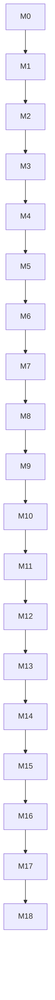

# Implementation Plan

## Related Documents

- [Requirements](./02_REQUIREMENTS.md)
- [User Stories](./03_USER_STORIES.md)
- [System Architecture](./04_SYSTEM_ARCHITECTURE.md)
- [Database Design](./05_DATABASE_DESIGN.md)
- [RBAC](./06_RBAC.md)
- [Authentication](./07_AUTHENTICATION.md)
- [API Strategy](./09_API_STRATEGY.md)
- [UI System](./10_UI_SYSTEM.md)
- [Component Library](./11_COMPONENT_LIBRARY.md)
- [Testing](./12_TESTING.md)
- [Deployment](./13_DEPLOYMENT.md)
- [AI Development Guide](./15_AI_DEVELOPMENT_GUIDE.md)
- [Repository and Free-Tier Audit](./19_REPOSITORY_AUDIT.md)

---

## Overview

Milestone-driven implementation plan from empty repository to MVP launch. Each milestone (M0–M18) produces a **working application increment**. Implement sequentially — do not skip milestones.

**Progress tracking:** Mark milestones complete in this section as implemented.

| Milestone | Name | Status |
|-----------|------|--------|
| M0 | Repository and Tooling Setup | Complete |
| M1 | Supabase Database and Environment | Complete; M3 replaces legacy Auth client assumptions |
| M2 | Database Schema and RLS | Complete; M3 adds Auth0 identity mapping |
| M3 | Authentication — Auth0 Google Login | Complete; live Auth0 profile provisioning, hosted migrations, and 22 SQL regression assertions verified |
| M4 | User Profile | Complete; authenticated onboarding, profile update, persistence, and validation flows verified |
| M5 | Community Creation | Complete; authenticated community setup, atomic creator-admin assignment, one-community rule, and RLS settings authorization verified |
| M6 | Event CRUD | Complete; authenticated create, publish, edit, cancel, and validation flows verified |
| M7 | Public Event Page | Complete; anonymous page, responsive layout, metadata, published-only visibility, and regression coverage verified |
| M8 | Join Event (FCFS) | Complete; atomic first-time community enrollment, authenticated join, guest return flow, and duplicate/closed-event checks verified |
| M9 | Waitlist | Complete |
| M10 | Leave and Auto-Promotion | Complete |
| M11 | Participant List | Complete |
| M12 | Attendance Management | Complete |
| M13 | Admin Dashboard | Complete |
| M14 | RBAC Hardening | Complete |
| M15 | Dark Mode and Polish | Complete |
| M16 | Testing Foundation | Not started |
| M17 | Deployment | Not started |
| M18 | MVP QA and Launch Prep | Not started |

---

## M0: Repository and Tooling Setup

### Objective

Initialize Next.js project with TypeScript, Tailwind, ESLint, Prettier, shadcn/ui foundation, and folder structure. Application runs locally with a minimal marketing landing page (app name and tagline only).

### Features

- pnpm project initialization
- Next.js App Router (latest stable)
- TypeScript strict mode
- Tailwind CSS configured with design token CSS variables skeleton
- ESLint + Prettier
- shadcn/ui init (Button, Card minimum)
- Folder structure per [System Architecture](./04_SYSTEM_ARCHITECTURE.md)
- Root layout with Geist font

### Files Expected

```
package.json
pnpm-lock.yaml
next.config.ts
tsconfig.json
tailwind.config.ts
postcss.config.mjs
.eslintrc.json (or eslint.config.mjs)
.prettierrc
.gitignore
.env.example
app/layout.tsx
app/page.tsx
app/globals.css
src/lib/utils.ts
components.json (shadcn)
src/components/ui/button.tsx
src/components/ui/card.tsx
```

### Acceptance Criteria

- [ ] `pnpm dev` starts without errors on localhost:3000
- [ ] Landing page renders with app name and brief tagline
- [ ] `pnpm lint` passes
- [ ] `pnpm typecheck` passes (script added to package.json)
- [ ] Tailwind classes work; CSS variables defined for theme skeleton
- [ ] `@/` import alias works

### Manual Test Checklist

- [ ] Open http://localhost:3000 — page loads
- [ ] Hot reload works on file change
- [ ] No console errors in browser

### Definition of Done

All acceptance criteria met. No feature code beyond landing page. `.env.example` documents required vars (values empty).

### Suggested Git Commit Message

```
chore: initialize Next.js project with tooling and folder structure (M0)
```

### Estimated Difficulty

2 / 5

### Estimated Time

2–4 hours

### Potential Risks

- shadcn/ui version mismatch with Tailwind v4 — pin compatible versions in docs if issue arises
- Windows path issues with pnpm — use forward slashes in imports

### Future Improvements

- Add Husky pre-commit hooks for lint (M17)
- Add commitlint for conventional commits

---

## M1: Supabase Database and Environment

### Objective

Connect local development to Supabase PostgreSQL (prefer local CLI) and establish database environment validation. Supabase Auth is not the identity provider; the current M1 auth/session helpers are legacy and must be replaced during M3.

### Features

- Supabase CLI initialized (`supabase init`)
- Local Supabase project; hosted project only after the free-tier audit approves it
- Environment variables in `.env.local`
- Server-side Supabase database client; only add browser access where a documented use case requires it
- Env validation with Zod (`src/lib/env.ts`)
- No Supabase Auth session refresh; Auth0 owns application sessions

### Files Expected

```
supabase/config.toml
src/lib/env.ts
src/lib/supabase/server.ts
.env.example (updated with real key placeholders)
```

### Acceptance Criteria

- [ ] `pnpm exec supabase start` runs locally; hosted project is not required
- [ ] Env validation fails loudly if vars missing in production build
- [ ] Server client creates without error in test Server Component
- [ ] Database client initializes without using Supabase Auth
- [ ] `.env.local` gitignored

### Manual Test Checklist

- [ ] App starts with valid `.env.local`
- [ ] App shows clear error or fails build with missing env vars
- [ ] Supabase Dashboard shows project (if cloud)

### Definition of Done

Supabase clients wired. No auth UI yet. Middleware refreshes session passively.

### Suggested Git Commit Message

```
feat: add Supabase client setup and environment validation (M1)
```

### Estimated Difficulty

2 / 5

### Estimated Time

2–3 hours

### Potential Risks

- Cookie issues in local dev — follow `@supabase/ssr` Next.js App Router guide exactly
- Forgetting to add middleware matcher — session won't refresh

### Future Improvements

- Separate staging Supabase project (M17)

---

## M2: Database Schema and RLS

### Objective

Deploy full PostgreSQL schema, enums, helper functions, join/leave RPC stubs, RLS policies, triggers, and seed data.

### Features

- All tables from [Database Design](./05_DATABASE_DESIGN.md)
- Enums: platform_role, community_role, event_status, participant_status, attendance_status
- Helper functions: is_super_admin, is_community_admin, is_community_member
- RPC: join_event, leave_event, promote_waitlisted, remove_participant
- RLS policies from [RBAC](./06_RBAC.md)
- Triggers: updated_at; legacy `handle_new_user` is Supabase Auth-specific and must be removed/replaced during M3
- Seed activity_types
- Generate TypeScript types

### Files Expected

```
supabase/migrations/20260101000000_initial_schema.sql
supabase/migrations/20260101000001_rls_policies.sql
supabase/migrations/20260101000002_rpc_functions.sql
supabase/seed.sql
src/types/database.ts
```

### Acceptance Criteria

- [ ] `pnpm exec supabase db reset` applies all migrations and seed without error
- [ ] All tables exist with correct columns and indexes
- [ ] RLS enabled on all tables
- [ ] activity_types seeded with badminton, pickleball, general
- [ ] New auth user trigger creates profiles row
- [ ] join_event RPC callable (test via SQL editor with test user)
- [ ] TypeScript types generated

### Manual Test Checklist

- [ ] Supabase Table Editor shows all tables
- [ ] Anonymous SELECT on published event works (after test data inserted manually)
- [ ] Direct INSERT to event_participants blocked for authenticated user
- [ ] join_event returns confirmed for first joiner on test event

### Definition of Done

Schema matches Database Design doc. RLS policies match RBAC doc. RPC functions implement FCFS logic.

### Suggested Git Commit Message

```
feat: add database schema, RLS policies, and join/leave RPC functions (M2)
```

### Estimated Difficulty

5 / 5

### Estimated Time

6–10 hours

### Potential Risks

- RLS policy recursion — use SECURITY DEFINER helpers carefully
- Race conditions in join_event — ensure FOR UPDATE locking
- Migration ordering — functions after tables

### Future Improvements

- SQL unit tests for RPC functions
- Audit log trigger automation

---

## M3: Authentication — Auth0 Google Login

### Objective

Users sign in through Auth0 using Google as a federated connection. Auth0 is the only identity provider; Supabase provides PostgreSQL/RLS only. Protected routes redirect unauthenticated users, and the server/data boundary validates the Auth0 identity. The previous Supabase Auth implementation has been replaced; the hosted schema and live Auth0-to-Supabase profile flow are verified.

### Features

- Auth0 official Next.js SDK using its current App Router/OIDC Authorization Code + PKCE pattern
- Login page with "Continue with Google" initiating the Auth0-hosted flow
- Auth0 SDK callback/logout routes and secure SDK-managed session
- Middleware/proxy protects `/dashboard/**` as defense in depth
- Redirect authenticated users from `/login`
- Return URL (`next` param) support
- Supabase Auth0 third-party JWT integration, including the required Auth0 Action claim
- Internal UUID profile mapping keyed by validated Auth0 issuer + subject
- Replace every Supabase Auth `auth.users`/`auth.uid()` dependency in schema, RLS, triggers, and RPCs
- Keep platform/community RBAC in PostgreSQL and enforce it with RLS; Auth0 tokens do not grant product roles
- pgTAP regression tests for claim-to-profile mapping, idempotent provisioning, and role/identity update restrictions

### Files Expected

```
app/(auth)/login/page.tsx
Auth0 SDK route/session configuration and callback
src/features/auth/queries.ts
app/(dashboard)/layout.tsx
app/(dashboard)/dashboard/page.tsx (placeholder dashboard route)
proxy.ts (Next.js 16; follow the current Auth0 SDK convention)
```

### Acceptance Criteria

- [x] Auth0 sign-in completes using the SDK and creates a secure session (verified with the Auth0 database connection; Google connection redirect was checked, but full Google consent was not performed)
- [x] Supabase accepts the real Auth0 ID token; unauthenticated access is denied
- [x] Profile row is created/resolved race-safely from validated issuer + subject
- [x] `/dashboard` inaccessible without auth
- [x] Sign out clears session
- [x] Login redirects to `next` param when safe
- [x] Authenticated user visiting `/login` redirects to dashboard
- [x] RLS and RPC tests prove caller-to-profile mapping and prevent forged role escalation
- [x] No application path uses Supabase Auth or trusts browser-provided role values

Expired- and wrong-audience-token rejection were not separately exercised with crafted tokens. The live flow verifies acceptance of the actual Auth0 ID token, and the regression SQL verifies database authorization behavior. The official `supabase test db --linked` runner was unavailable without Docker/Podman; all 22 SQL assertions were instead executed successfully through `supabase db query --linked --file`.

### Manual Test Checklist

- [ ] Complete Google consent and sign in through Auth0 on localhost (the Google connection redirect was checked; full consent was not performed)
- [x] Refresh page — still authenticated
- [x] Sign out — redirected to login
- [x] Visit /dashboard unauthenticated — redirected to login
- [x] Login with `?next=/dashboard/settings` — lands on settings

### Definition of Done

The live Auth0 flow and trusted Auth0-to-PostgreSQL identity mapping work per [Authentication](./07_AUTHENTICATION.md), [RBAC](./06_RBAC.md), and [Repository Audit](./19_REPOSITORY_AUDIT.md). Dashboard shell exists. No hosted provider is required for local lint/typecheck/unit tests.

### Suggested Git Commit Message

```
feat: implement Auth0 sign-in and protected routes (M3)
```

### Estimated Difficulty

3 / 5

### Estimated Time

4–6 hours

### Potential Risks

- Auth0 callback URL mismatch — verify local/production callback and logout URLs
- Supabase third-party JWT claim configuration mismatch — validate the exact ID-token claim and issuer/audience contract
- Auth0 `sub` is not the internal UUID profile ID — use the reviewed issuer/subject mapping

### Future Improvements

- Additional login methods only after product need and free-tier evaluation
- Account linking only after a separate identity/security review

---

## M4: User Profile

### Objective

Users view and edit profile. Onboarding flow for new users to confirm display name.

### Features

- getCurrentProfile query
- updateProfile Server Action with Zod validation
- Profile settings page
- Onboarding page for new users (redirect until profile setup is completed)
- Persisted onboarding state so provider-supplied names do not bypass first-login setup
- Avatar URL field (upload deferred to Storage setup or URL input for MVP)

### Files Expected

```
src/lib/validations/profile.ts
src/features/auth/actions.ts (updateProfile)
src/features/auth/queries.ts (getCurrentProfile)
src/features/auth/components/profile-form.tsx
app/(dashboard)/dashboard/settings/page.tsx
app/onboarding/page.tsx
supabase/migrations/20260101000004_profile_onboarding.sql
```

### Acceptance Criteria

- [x] User can view profile on settings page
- [x] User can update display name and phone
- [x] Validation errors show inline
- [x] New user redirected to onboarding once
- [x] Profile changes reflect in database

### Manual Test Checklist

- [x] First sign-in redirects to onboarding
- [x] Save display name — appears in settings after reload
- [x] Invalid phone format rejected inline
- [x] Skip onboarding not possible without valid name

The authenticated UI was tested with a disposable Auth0 database user. The first-login flow is tracked explicitly by `profiles.onboarding_completed`, rather than guessing completion from the display name supplied by an identity provider. Existing named profiles are preserved as complete; newly provisioned profiles start incomplete until a validated profile update succeeds.

### Definition of Done

Profile CRUD complete. FR-PROFILE requirements met.

### Suggested Git Commit Message

```
feat: add user profile settings and onboarding flow (M4)
```

### Estimated Difficulty

2 / 5

### Estimated Time

3–5 hours

### Potential Risks

- Onboarding redirect loop — check condition carefully
- Avatar upload complexity — use URL input for MVP if Storage not ready

### Future Improvements

- Supabase Storage avatar upload
- Profile photo crop

---

## M5: Community Creation

### Objective

Admin creates and manages one community. MVP enforces one community per admin.

### Features

- createCommunity and updateCommunity actions
- Community creation onboarding step (after profile)
- Community settings page
- Auto-add creator as community admin in community_members
- Slug generation from name
- Activity type select (from seed data)

### Files Expected

```
src/lib/validations/community.ts
src/features/communities/actions.ts
src/features/communities/queries.ts
src/features/communities/components/community-form.tsx
app/(dashboard)/community/page.tsx
app/(dashboard)/community/setup/page.tsx
```

### Acceptance Criteria

- [x] Admin creates community with name, slug, description, activity type
- [x] Creator assigned admin role in community_members
- [x] MVP blocks second community creation for same user
- [x] Admin can edit community settings
- [x] Non-admin cannot access community settings

### Manual Test Checklist

- [x] Create badminton community — success (verified in authenticated browser)
- [x] Creator appears as admin member (atomic database regression assertion)
- [x] Edit description — saved (admin update verified in SQL regression test; settings form rendered in authenticated browser)
- [x] Attempt second community — rejected with message (database regression assertion)
- [x] Duplicate slug rejected (database unique-index regression assertion)

The authenticated browser verified community creation and settings page access. Hosted SQL regression assertions verify creator/admin assignment, the single-community limit, direct-insert denial, admin updates, non-admin RLS denial, and duplicate-slug rejection.

### Definition of Done

Community module complete. FR-COMMUNITY MVP requirements met.

### Suggested Git Commit Message

```
feat: add community creation and settings (M5)
```

### Estimated Difficulty

3 / 5

### Estimated Time

4–6 hours

### Potential Risks

- User without community accessing dashboard — redirect to community setup
- Slug uniqueness with soft deletes — partial index handles this

### Future Improvements

- Multiple communities per admin (Phase 2)

---

## M6: Event CRUD

### Objective

Admin creates, edits, publishes, and cancels events. Share slug generated. Event list in dashboard.

### Features

- createEvent, updateEvent, publishEvent, cancelEvent actions
- Event form with Zod validation
- Event list page (dashboard)
- Event detail page (admin view)
- share_slug generation (8 URL-safe characters from cryptographic random bytes)
- Copy share link button
- Event statuses: draft, published, cancelled

### Files Expected

```
src/lib/validations/event.ts
src/lib/utils/event.ts
src/lib/utils/event-share.ts
src/features/events/actions.ts
src/features/events/queries.ts
src/features/events/components/event-form.tsx
src/features/events/components/event-management-actions.tsx
src/components/domain/event-card.tsx
src/components/domain/copy-share-link-button.tsx
app/(dashboard)/events/page.tsx
app/(dashboard)/events/new/page.tsx
app/(dashboard)/events/[id]/page.tsx
```

### Acceptance Criteria

- [x] Admin creates event with all required fields
- [x] Event saved as draft or published
- [x] share_slug unique and URL-safe
- [x] Admin edits event before start
- [x] Admin cancels event with confirmation
- [x] Copy link produces `{APP_URL}/e/{slug}`
- [x] Member cannot create events

**Implementation status:** M6 routes, Server Actions, validation, event list/detail, share-link UI, and database privileges/default are implemented and verified. Migration `20260101000007_event_crud_privileges.sql` is applied to the linked project. Lint, typecheck, production build, all 41 hosted SQL assertions, and authenticated browser checks pass. The regression suite covers non-admin event-creation denial and anonymous draft-event denial. Temporary QA event, community, membership, and profile rows were removed after browser verification. The official pgTAP runner remains unavailable without Docker/Podman.

### Manual Test Checklist

- [x] Create draft event — not public
- [x] Publish event — status published
- [x] Copy share link — correct format
- [x] Edit title — saved
- [x] Cancel event — status cancelled
- [x] End before start validation fails

### Definition of Done

Event CRUD complete. FR-EVENT requirements met except public page (M7).

### Suggested Git Commit Message

```
feat: add event CRUD with share slug generation (M6)
```

### Estimated Difficulty

3 / 5

### Estimated Time

5–8 hours

### Potential Risks

- Timezone handling — store UTC, display local
- nanoid collision — retry on unique constraint violation

### Future Improvements

- Recurring events series
- Event templates

---

## M7: Public Event Page

### Objective

Mobile-first public event page accessible via share link without authentication.

### Features

- Route `/e/[slug]`
- getEventBySlug query with confirmed count
- Event header: title, date, location, capacity bar
- Participant count display
- Join button UI shell (wired to joinEvent action in M8)
- Published events only; 404 for draft/deleted
- SEO metadata (generateMetadata)
- Public layout (minimal nav)

### Files Expected

```
app/(public)/e/[slug]/page.tsx
app/(public)/layout.tsx
src/features/events/queries.ts (getEventBySlug, getEventWithCounts)
src/features/events/components/event-header.tsx
src/features/events/components/capacity-bar.tsx
src/components/layout/navbar.tsx (public variant)
```

### Acceptance Criteria

- [x] `/e/{slug}` loads without auth for published events
- [x] Shows title, schedule, location, capacity, confirmed count
- [x] Draft/cancelled/deleted events are not exposed (404)
- [x] Mobile layout works at 375px
- [x] Page has meaningful title in browser tab

### Manual Test Checklist

- [x] Open share link anonymously — event details visible
- [x] Draft/cancelled/deleted events are unavailable; published-only RLS intentionally returns 404 rather than disclosing event state
- [x] Invalid slug — 404 page
- [x] Capacity bar shows correct fraction

### Definition of Done

**Implementation status:** `/e/[slug]` renders published events anonymously with event details, confirmed-participant capacity, responsive layout, and metadata. The hosted regression suite verifies that anonymous users can read published events but cannot read draft or cancelled events. Browser checks confirmed the share page at 375px and 404 handling for invalid slugs. Lint, typecheck, production build, and all 43 hosted SQL assertions pass. The official pgTAP runner remains unavailable without Docker/Podman.

Public event page complete. US-EVENT-03 satisfied.

### Suggested Git Commit Message

```
feat: add mobile-first public event page via share slug (M7)
```

### Estimated Difficulty

2 / 5

### Estimated Time

3–5 hours

### Potential Risks

- RLS blocking public SELECT — verify events_public_select policy
- Date formatting locale — use consistent formatter utility

### Future Improvements

- Open Graph tags for WhatsApp previews (Phase 1)

---

## M8: Join Event (FCFS)

### Objective

Authenticated community members join published events. FCFS confirmed status until capacity.

### Features

- joinEvent Server Action calling join_event RPC
- JoinEventButton client component with loading state
- Auto-add user to community_members on first join (if not member)
- Guest redirected to login with return URL
- Display user's participation status (confirmed)
- revalidatePath on join

### Files Expected

```
src/features/participants/actions.ts (joinEvent)
src/features/participants/queries.ts (getUserParticipation)
src/features/participants/components/join-event-button.tsx
app/(public)/e/[slug]/page.tsx (updated)
src/lib/validations/participant.ts
```

### Acceptance Criteria

- [x] Authenticated user joins — status confirmed
- [x] Confirmed count increments
- [x] Guest tap join — redirect to login with return URL
- [x] Cannot join draft/cancelled/past events
- [x] Cannot join twice (conflict error)
- [x] Concurrent joins respect capacity (event-row lock in RPC)

### Manual Test Checklist

- [ ] Join as first-time authenticated user — confirmed and community membership created atomically in the browser
- [x] Join as guest — login prompt with return URL
- [ ] Complete Auth0 sign-in from the return URL in a browser session
- [ ] Second join attempt — conflict message shown in the browser
- [ ] Join published event — success shown in the browser

### Definition of Done

**Implementation status:** Authenticated users can join published future events through the `join_event` RPC. The RPC serializes joins on the event row, atomically creates first-time community membership, and rejects duplicate, anonymous, cancelled, and past-event joins. The public page displays the caller's participation status and confirmed capacity; guests are sent through login with a safe return path. Lint, typecheck, production build, the anonymous browser return-flow check, and all 49 hosted SQL assertions pass. The Auth0-authenticated join, status display, and action error state still need an end-to-end browser run.

FCFS join works for spots below capacity. FR-JOIN-01, FR-JOIN-02, FR-JOIN-06 met.

### Suggested Git Commit Message

```
feat: implement FCFS event join via atomic RPC (M8)
```

### Estimated Difficulty

4 / 5

### Estimated Time

5–8 hours

### Potential Risks

- RPC auth context — ensure the trusted `current_profile_id()` mapping works safely in SECURITY DEFINER functions
- Community membership auto-add policy — document in migration

### Future Improvements

- Optimistic UI with useOptimistic

---

## M9: Waitlist

### Objective

When event full, new joiners automatically waitlisted with visible position.

### Features

- join_event RPC waitlist branch (if not already complete from M2)
- WaitlistCard component for user view
- Admin waitlist tab (basic list)
- Waitlist position display on event page
- Warning badge for waitlisted status

### Files Expected

```
src/components/domain/waitlist-card.tsx
src/features/participants/queries.ts (getWaitlistedParticipants)
app/(public)/e/[slug]/page.tsx (waitlist status)
app/(dashboard)/events/[id]/page.tsx (waitlist tab)
```

### Acceptance Criteria

- [x] Join when full — status waitlisted
- [x] User sees waitlist position (e.g., "#3 on waitlist")
- [x] Admin sees ordered waitlist
- [x] Member cannot see other users' waitlist positions
- [x] Confirmed users unaffected

### Manual Test Checklist

- [ ] Fill event to capacity
- [ ] Next join — waitlisted with position 1
- [ ] Another join — position 2
- [ ] Admin sees full waitlist order

### Definition of Done

Waitlist assignment and display complete. FR-WAITLIST-01, FR-WAITLIST-04 met.

### Implementation Notes

- The existing `join_event` RPC assigns the next waitlist position while holding the event row lock.
- The public event page renders only the authenticated caller's waitlist position.
- Community admins see the ordered waitlist on the event management page; RLS prevents members from reading other waitlisted users.

### Suggested Git Commit Message

```
feat: add automatic waitlist assignment and position display (M9)
```

### Estimated Difficulty

3 / 5

### Estimated Time

4–6 hours

### Potential Risks

- Waitlist position gaps after cancel — fixed in M10 promotion logic
- UI showing waitlist to wrong users — verify RLS

### Future Improvements

- Waitlist position change notifications

---

## M10: Leave and Auto-Promotion

### Objective

Users leave events. Confirmed user leaving promotes first waitlisted user automatically.

### Features

- leaveEvent Server Action calling leave_event RPC
- Leave button with ConfirmationDialog
- promote_waitlisted called on confirmed cancel
- Waitlist positions renumbered after waitlisted user leaves
- UI updates for promoted user on refresh

### Files Expected

```
src/features/participants/actions.ts (leaveEvent)
src/features/participants/components/leave-event-button.tsx
src/components/domain/confirmation-dialog.tsx
app/(public)/e/[slug]/page.tsx (leave button when joined)
```

### Acceptance Criteria

- [x] User leaves — status cancelled
- [x] Confirmed user leaves — first waitlisted promoted to confirmed
- [x] Promoted user's waitlist position cleared
- [x] Remaining waitlist positions contiguous
- [x] Leave requires confirmation
- [x] Cannot leave if not joined

### Manual Test Checklist

- [ ] Confirmed user leaves — count decrements
- [ ] Waitlisted user #1 becomes confirmed
- [ ] Former #2 now #1 on waitlist
- [ ] Waitlisted user leaves — positions renumber
- [ ] Leave cancelled event participant — appropriate handling

### Definition of Done

Auto-promotion works synchronously. FR-JOIN-04, FR-WAITLIST-02, FR-WAITLIST-03 met.

### Implementation Notes

- The `leave_event` RPC serializes against the event row, cancels the caller's active participation, promotes the first waitlisted participant when a confirmed spot opens, and renumbers remaining waitlist positions.
- The server action validates the RPC response and revalidates the public event page after a successful leave.
- Leaving is protected by an explicit confirmation dialog; users who are not actively joined receive a safe conflict error.

### Suggested Git Commit Message

```
feat: implement leave event with automatic waitlist promotion (M10)
```

### Estimated Difficulty

4 / 5

### Estimated Time

4–6 hours

### Potential Risks

- Promotion race with simultaneous leave/join — RPC transaction must serialize
- UI stale after promotion — revalidatePath critical

### Future Improvements

- Realtime promotion updates without refresh

---

## M11: Participant List

### Objective

Ordered participant list on event pages. Admin can remove participants.

### Features

- ParticipantList component
- getConfirmedParticipants query with pagination support
- removeParticipant action (admin) via RPC
- Admin remove triggers promotion
- "You" badge for current user
- Numbered list by join order

### Files Expected

```
src/components/domain/participant-list.tsx
src/features/participants/actions.ts (removeParticipant)
src/features/participants/queries.ts (getConfirmedParticipants)
app/(public)/e/[slug]/page.tsx (participant list)
app/(dashboard)/events/[id]/page.tsx (admin participant management)
```

### Acceptance Criteria

- [x] Public event page shows confirmed participants
- [x] List ordered by joined_at ASC
- [x] Avatar and display name shown
- [x] Admin removes participant — confirmation + promotion if confirmed
- [x] Member cannot remove others
- [x] Empty state when no participants

### Manual Test Checklist

- [ ] 5 participants — correct order
- [ ] Admin remove confirmed — waitlist promotes
- [ ] Member view — no remove buttons
- [ ] Current user highlighted

### Definition of Done

Participant list and admin removal complete. FR-PARTICIPANTS met.

### Implementation Notes

- Public and admin participant lists read only confirmed records and order by `joined_at`.
- Admin removal calls the existing authorization-enforcing `remove_participant` RPC, which promotes waitlisted users when a confirmed participant is removed.

### Suggested Git Commit Message

```
feat: add participant list and admin remove with promotion (M11)
```

### Estimated Difficulty

3 / 5

### Estimated Time

4–6 hours

### Potential Risks

- Pagination needed for large events — implement if >50 (optional MVP)
- Remove self vs leave — both should work; leave preferred for self

### Future Improvements

- Realtime list updates
- Export participant CSV

---

## M12: Attendance Management

### Objective

Admin marks attendance for confirmed participants on event day.

### Features

- markAttendance and bulkMarkAttendance actions
- AttendanceCard or attendance list UI
- Attendance tab on admin event page
- Status: present, absent, no_show
- Attendance summary counts

### Files Expected

```
src/lib/validations/attendance.ts
src/features/attendance/actions.ts
src/features/attendance/queries.ts
src/components/domain/attendance-card.tsx
app/(dashboard)/events/[id]/attendance/page.tsx
```

### Acceptance Criteria

- [x] Admin marks individual attendance status
- [x] Only confirmed participants appear
- [x] Summary shows present/absent/no-show/unmarked counts
- [x] Member cannot mark attendance
- [x] Updates persist and survive refresh

### Manual Test Checklist

- [ ] Mark 3 present, 1 absent, 1 no-show — counts correct
- [ ] Change status — updates
- [ ] Member accessing attendance URL — denied

### Definition of Done

Attendance module complete. FR-ATTENDANCE met.

### Implementation Notes

- The attendance route performs server-side community-admin authorization before loading participants.
- Attendance writes use an upsert keyed by the existing unique `participant_id` constraint; RLS and explicit column privileges protect the write.

### Suggested Git Commit Message

```
feat: add admin attendance marking and summary (M12)
```

### Estimated Difficulty

2 / 5

### Estimated Time

3–5 hours

### Potential Risks

- Marking before event — optional warning in UI
- Duplicate attendance records — unique constraint on participant_id

### Future Improvements

- QR check-in (Phase 5)

---

## M13: Admin Dashboard

### Objective

Polished admin dashboard with upcoming events, quick actions, and navigation shell.

### Features

- Dashboard home with upcoming events grid/list
- StatisticsCard components (upcoming count, weekly participants)
- Sidebar (desktop) and BottomNav (mobile)
- Quick create event button
- Copy share link from event cards
- Empty state when no events

### Files Expected

```
app/(dashboard)/dashboard/page.tsx (dashboard home)
src/components/layout/sidebar.tsx
src/components/layout/bottom-nav.tsx
src/components/domain/statistics-card.tsx
src/components/domain/empty-state.tsx
app/(dashboard)/layout.tsx (updated with nav)
```

### Acceptance Criteria

- [x] Dashboard shows upcoming published events
- [x] Event cards show capacity and confirmed count
- [x] Create event accessible from dashboard
- [x] Copy link works from dashboard
- [x] Mobile bottom nav; desktop sidebar
- [x] Empty state for new admin with no events

### Manual Test Checklist

- [ ] Dashboard loads with events
- [ ] Navigate all nav items on mobile and desktop
- [ ] Create event from dashboard CTA
- [ ] Statistics show plausible numbers

### Definition of Done

Admin dashboard complete. FR-ADMIN met.

### Implementation Notes

- The dashboard queries only upcoming published events for the signed-in user's community and includes confirmed counts.
- Navigation uses a desktop sidebar and mobile bottom bar; event cards expose the existing copy-link interaction.

### Suggested Git Commit Message

```
feat: add admin dashboard with navigation and event overview (M13)
```

### Estimated Difficulty

3 / 5

### Estimated Time

5–8 hours

### Potential Risks

- Layout shift between mobile/desktop — test both breakpoints
- Stats query performance — simple counts acceptable for MVP

### Future Improvements

- Analytics charts (Phase 5)

---

## M14: RBAC Hardening

### Objective

Audit and verify all RLS policies. Role-gated UI matches permissions. No authorization gaps.

### Features

- Review all policies against [RBAC](./06_RBAC.md) matrix
- requireCommunityAdmin, requireSuperAdmin helpers
- UI guards on all admin actions
- Fix any policy gaps found
- Document super admin bootstrap SQL
- RBAC test checklist execution

### Files Expected

```
src/lib/auth/roles.ts
supabase/migrations/20260101000003_rls_fixes.sql (if needed)
src/features/**/** (UI guard updates across features)
```

### Acceptance Criteria

- [x] Every RBAC matrix row verified
- [x] Direct Supabase client cannot bypass restrictions
- [x] UI hides unauthorized actions
- [x] Super admin can access all resources
- [x] RBAC manual test checklist all pass

### Manual Test Checklist

- [ ] Guest: public event only
- [ ] Member: join own community, no create event
- [ ] Admin: full community management
- [ ] Cross-community access denied
- [ ] Direct INSERT participant denied

### Definition of Done

Security audit complete. FR-RBAC fully enforced.

### Implementation Notes

- `requireCommunityAdmin`, `requireSuperAdmin`, and `getCommunityRole` centralize app-layer checks for UX while PostgreSQL RLS and SECURITY DEFINER RPCs remain authoritative.
- Participant mutation privileges are explicitly revoked from browser roles; joining, leaving, and removal remain available only through their authorized RPCs.
- Attendance delete is explicitly denied; attendance is created or updated only by an authorized community admin.

### Suggested Git Commit Message

```
fix: harden RBAC with RLS audit and UI role guards (M14)
```

### Estimated Difficulty

4 / 5

### Estimated Time

4–8 hours

### Potential Risks

- Overly restrictive policy breaks legitimate access — test each role
- Missing policy on new table — checklist prevents this

### Future Improvements

- Automated RLS tests in CI

---

## M15: Dark Mode and Polish

### Objective

Premium UI polish: dark mode default, light toggle, motion, loading/empty/error states everywhere.

### Features

- next-themes integration (class strategy)
- Complete CSS variables for dark and light per [UI System](./10_UI_SYSTEM.md)
- Theme toggle in navbar
- Framer Motion page transitions and list stagger
- LoadingState, EmptyState, ErrorState on all primary views
- Toast notifications for all actions
- Button gradient variant
- prefers-reduced-motion support

### Files Expected

```
app/globals.css (full tokens)
src/components/theme-provider.tsx
src/components/theme-toggle.tsx
src/components/domain/loading-state.tsx
src/components/domain/error-state.tsx
src/components/ui/toast.tsx (shadcn)
tailwind.config.ts (extended theme)
Multiple page updates for states and motion
```

### Acceptance Criteria

- [x] Dark mode default; toggle persists
- [x] Light mode fully styled (no broken contrast)
- [x] Dashboard async view has a loading skeleton
- [x] Primary lists have empty states
- [x] Errors show accessible ErrorState-compatible messaging
- [x] Animations respect reduced motion
- [x] UI matches Component Library specs

### Manual Test Checklist

- [ ] Toggle theme — all pages work
- [ ] Join/leave/create — toasts appear
- [ ] Empty dashboard — delightful empty state
- [ ] Slow network — skeletons visible
- [ ] Mobile polish at 375px

### Definition of Done

Premium UI standards met. FR-UI requirements satisfied.

### Suggested Git Commit Message

```
feat: add dark mode, motion, and polished loading/empty/error states (M15)
```

### Estimated Difficulty

3 / 5

### Estimated Time

6–10 hours

### Potential Risks

- Flash of wrong theme — use suppressHydrationWarning on html
- Over-animation — keep subtle per UI System

### Future Improvements

- Custom community branding colors

---

## M16: Testing Foundation

### Objective

Vitest and Playwright configured with core tests for validation, auth, join, and waitlist promotion.

### Features

- Vitest config and unit tests for Zod schemas
- Playwright config with auth setup
- E2E: auth flow, join event, waitlist promotion
- axe-core a11y scan on public event page
- npm scripts: test, e2e, test:coverage

### Files Expected

```
vitest.config.ts
playwright.config.ts
tests/unit/validations/*.test.ts
tests/e2e/auth.spec.ts
tests/e2e/join-event.spec.ts
tests/e2e/waitlist-promotion.spec.ts
tests/fixtures/auth.setup.ts
package.json (scripts)
```

### Acceptance Criteria

- [ ] `pnpm test` passes all unit tests
- [ ] `pnpm e2e` passes critical flows (with test Supabase)
- [ ] CI-ready test scripts documented
- [ ] At least 10 unit tests for validation schemas
- [ ] E2E covers join and promotion happy paths

### Manual Test Checklist

- [ ] Run unit tests locally — green
- [ ] Run E2E against local dev — green
- [ ] A11y scan — no critical violations

### Definition of Done

Testing infrastructure per [Testing](./12_TESTING.md). Regression suite for core flows.

### Suggested Git Commit Message

```
test: add Vitest unit tests and Playwright E2E for core flows (M16)
```

### Estimated Difficulty

4 / 5

### Estimated Time

6–10 hours

### Potential Risks

- E2E OAuth hard to automate — use test user session injection or dedicated test provider
- Flaky waitlist test — use deterministic seed data

### Future Improvements

- Full RBAC E2E matrix
- CI E2E on every PR

---

## M17: Deployment

### Objective

Production deployment to an eligible host and database configuration only after official free-tier, terms, payment, and recovery verification; CI pipeline included. Vercel Hobby is conditional and not presumed eligible.

### Features

- Approved eligible host connected to GitHub (no paid plan or usage-based billing)
- Hosted PostgreSQL only after free-tier and recovery review; migrations applied
- Environment variables configured
- GitHub Actions CI: lint, typecheck, tests, build, dependency and secret checks
- Auth0 Google connection with production callback/logout URLs
- Custom domain (optional)
- Storage bucket for avatars (if not done in M4)

### Files Expected

```
.github/workflows/ci.yml
.env.example (final)
README.md (deploy section updated in M18)
```

### Acceptance Criteria

- [ ] Production URL loads application
- [ ] Auth0 sign-in works on production domain
- [ ] Database migrations applied to production
- [ ] CI passes on push to main
- [ ] Preview deploys work within the verified free allowance, if supported
- [ ] No secrets in client bundle

### Manual Test Checklist

- [ ] Sign in on production
- [ ] Create event on production
- [ ] Share link works from mobile
- [ ] Join flow works on production
- [ ] CI green on main branch

### Definition of Done

Live production environment. [Deployment](./13_DEPLOYMENT.md) checklist complete.

### Suggested Git Commit Message

```
chore: add CI pipeline and configure production deployment (M17)
```

### Estimated Difficulty

3 / 5

### Estimated Time

4–6 hours

### Potential Risks

- Auth0 callback/logout mismatch on production domain
- Host eligibility or quota does not fit production use; pause rather than upgrade or incur cost
- Migration drift between local and prod — always push migrations first

### Future Improvements

- Staging environment
- Sentry error tracking

---

## M18: MVP QA and Launch Prep

### Objective

Full manual QA, performance pass, documentation update, super admin bootstrap. MVP ready for real users.

### Features

- Execute full manual QA checklist from [Testing](./12_TESTING.md)
- Fix critical bugs found
- Update README with setup and usage instructions
- Bootstrap super admin in production
- Lighthouse performance check on public event page
- Mark all milestones complete in this document
- Smoke test on iOS Safari and Android Chrome

### Files Expected

```
README.md (updated)
docs/16_IMPLEMENTATION_PLAN.md (progress marked complete)
Bug fixes as needed (minimal scope)
```

### Acceptance Criteria

- [ ] All MVP requirements from [Requirements](./02_REQUIREMENTS.md) verified
- [ ] Manual QA checklist 100% pass
- [ ] No critical or high severity open bugs
- [ ] README accurate for new developer setup
- [ ] LCP < 2.5s on public event page (mobile lab test)
- [ ] Super admin bootstrapped
- [ ] First real community can be created end-to-end

### Manual Test Checklist

Use complete checklist from [Testing](./12_TESTING.md) — Authentication through Cross-Browser sections.

### Definition of Done

**MVP LAUNCH READY.** Product replaces WhatsApp participant lists for first real community.

### Suggested Git Commit Message

```
docs: complete MVP QA and update README for launch (M18)
```

### Estimated Difficulty

3 / 5

### Estimated Time

4–8 hours

### Potential Risks

- Scope creep fixing non-critical bugs — prioritize launch blockers only
- Last-minute feature requests — defer to Phase 1 roadmap

### Future Improvements

- Begin Phase 1 notifications per [Roadmap](./17_ROADMAP.md)

---

## Milestone Dependency Graph



---

## Total Estimated Timeline

| Phase | Milestones | Estimated Time |
|-------|------------|----------------|
| Setup | M0–M2 | 10–17 hours |
| Core platform | M3–M7 | 19–32 hours |
| Participation | M8–M12 | 20–31 hours |
| Polish and launch | M13–M18 | 27–48 hours |
| **Total** | M0–M18 | **76–128 hours** |

Estimate for solo developer with AI assistance: **4–8 weeks** at part-time pace.

---

## AI Session Quick Reference

To start implementing, prompt:

```
Read docs/16_IMPLEMENTATION_PLAN.md and implement the next incomplete milestone.
Follow docs/15_AI_DEVELOPMENT_GUIDE.md session protocol.
Do not skip milestones or add out-of-scope features.
```
