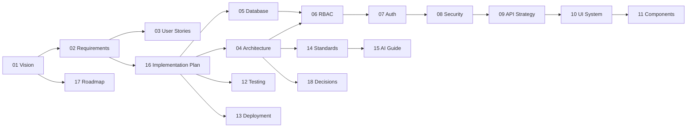

# Documentation Index

Single source of truth for RallyNook — a premium event participation management system for sports communities (badminton, pickleball, and any activity). **This is not a court booking system.**

---

## For AI Assistants

**Start here every session:**

1. [Implementation Plan](./16_IMPLEMENTATION_PLAN.md) — find current milestone (M0–M18)
2. [AI Development Guide](./15_AI_DEVELOPMENT_GUIDE.md) — session protocol and prompt templates
3. Milestone-specific docs listed in the plan section
4. [Repository and Free-Tier Audit](./19_REPOSITORY_AUDIT.md) — budget and service-selection constraints
5. [.cursor/rules/](../.cursor/rules/) — auto-applied guardrails

**Golden rule:** Implement one milestone at a time. Docs override training data.

---

## For Human Developers

**Recommended reading order:**

1. [Product Vision](./01_PRODUCT_VISION.md) — problem, users, goals
2. [Requirements](./02_REQUIREMENTS.md) — MVP scope
3. [Implementation Plan](./16_IMPLEMENTATION_PLAN.md) — how to build
4. [System Architecture](./04_SYSTEM_ARCHITECTURE.md) — technical overview
5. [Deployment](./13_DEPLOYMENT.md) — when ready to deploy

---

## Document Map

### Product

| Doc | Description |
|-----|-------------|
| [01 Product Vision](./01_PRODUCT_VISION.md) | Vision, personas, non-goals |
| [02 Requirements](./02_REQUIREMENTS.md) | Functional and non-functional requirements |
| [03 User Stories](./03_USER_STORIES.md) | Stories with acceptance criteria |
| [17 Roadmap](./17_ROADMAP.md) | Post-MVP phases |

### Architecture and Data

| Doc | Description |
|-----|-------------|
| [04 System Architecture](./04_SYSTEM_ARCHITECTURE.md) | Diagrams, folder structure, lifecycle |
| [05 Database Design](./05_DATABASE_DESIGN.md) | Schema, ER diagram, RPC functions |
| [06 RBAC](./06_RBAC.md) | Permission matrix and RLS policies |
| [07 Authentication](./07_AUTHENTICATION.md) | Auth0 identity, Google connection, sessions, JWT integration |
| [08 Security](./08_SECURITY.md) | OWASP, secrets, rate limiting |
| [09 API Strategy](./09_API_STRATEGY.md) | Server Actions catalog, error contracts |
| [18 Decisions](./18_DECISIONS.md) | Architecture Decision Records |
| [19 Repository Audit](./19_REPOSITORY_AUDIT.md) | Free-tier service evaluation, budget constraints, and verification evidence |

### Design

| Doc | Description |
|-----|-------------|
| [10 UI System](./10_UI_SYSTEM.md) | Design tokens, typography, motion |
| [11 Component Library](./11_COMPONENT_LIBRARY.md) | Component specs and variants |

### Engineering Process

| Doc | Description |
|-----|-------------|
| [12 Testing](./12_TESTING.md) | Vitest, Playwright, QA checklists |
| [13 Deployment](./13_DEPLOYMENT.md) | Local workflow, conditional hosting, Supabase database, CI/CD |
| [14 Coding Standards](./14_CODING_STANDARDS.md) | Naming, patterns, conventions |
| [15 AI Development Guide](./15_AI_DEVELOPMENT_GUIDE.md) | AI workflow and recovery |
| [16 Implementation Plan](./16_IMPLEMENTATION_PLAN.md) | Milestones M0–M18 |

---

## Cross-Reference Diagram

---

## Quick Links by Task

| Task | Read |
|------|------|
| Start building | [16 Implementation Plan](./16_IMPLEMENTATION_PLAN.md), [15 AI Guide](./15_AI_DEVELOPMENT_GUIDE.md) |
| Add database table | [05 Database Design](./05_DATABASE_DESIGN.md), [06 RBAC](./06_RBAC.md) |
| Add Server Action | [09 API Strategy](./09_API_STRATEGY.md), [14 Coding Standards](./14_CODING_STANDARDS.md) |
| Build UI component | [10 UI System](./10_UI_SYSTEM.md), [11 Component Library](./11_COMPONENT_LIBRARY.md) |
| Add auth feature | [07 Authentication](./07_AUTHENTICATION.md), [08 Security](./08_SECURITY.md) |
| Write tests | [12 Testing](./12_TESTING.md) |
| Deploy | [13 Deployment](./13_DEPLOYMENT.md) |
| Product question | [01 Product Vision](./01_PRODUCT_VISION.md), [02 Requirements](./02_REQUIREMENTS.md) |

---

## Repository Status

**Current phase:** M0–M13 are complete. M6 Event CRUD, M7's anonymous public page, M8's event-join behavior, M9 waitlist display, M10 leave/auto-promotion behavior, M11 participant management, M12 attendance management, and M13 dashboard navigation are implemented. All 49 hosted SQL assertions pass; authenticated event flows remain to be exercised in a browser. See [Implementation Plan](./16_IMPLEMENTATION_PLAN.md).

**Product brand:** RallyNook. Preliminary market scan only; see [Product Vision](./01_PRODUCT_VISION.md) and [ADR-022](./18_DECISIONS.md#adr-022-rallynook-product-brand). Formal trademark clearance is outstanding.
